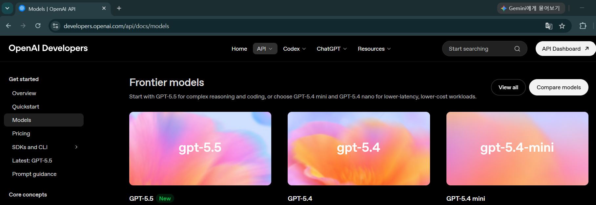
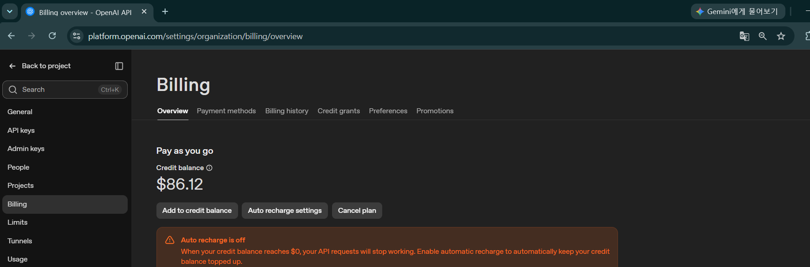
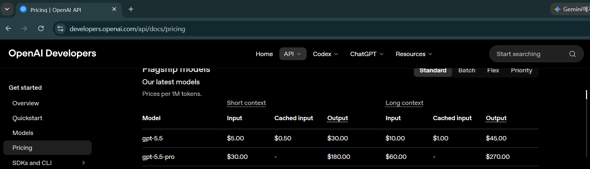
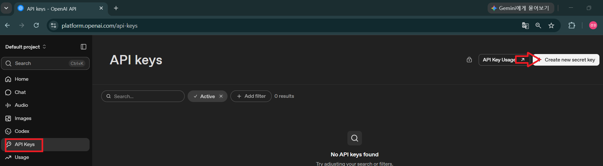
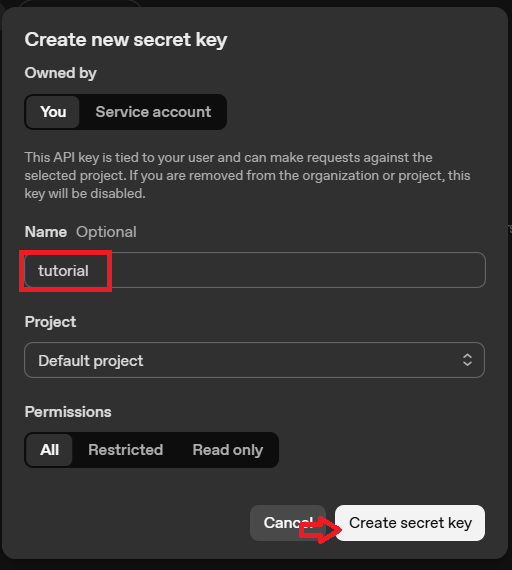
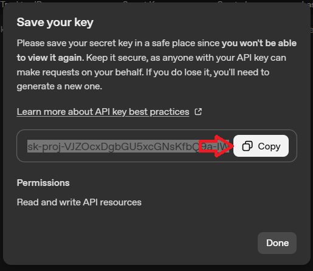
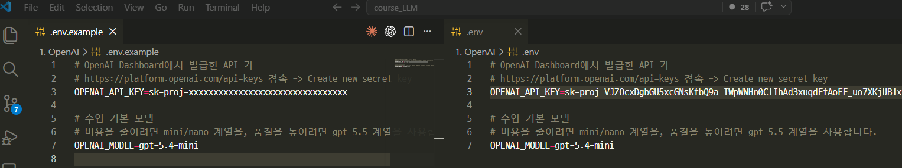
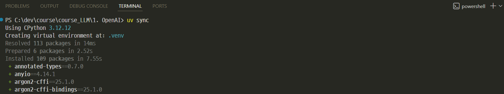

# [OpenAI란](https://openai.com/ko-KR/)
> OpenAI는 인공지능(AI) 연구와 서비스를 개발하는 기업으로, 사람들에게 도움이 되는 범용 인공지능(AGI, Artificial General Intelligence)을 안전하게 개발하고 널리 활용할 수 있도록 하는 것을 목표로 합니다.

대표적으로 ChatGPT, GPT 시리즈, DALL·E, Whisper 등의 AI 모델을 개발했으며, 개발자를 위한 API도 제공합니다.

---
## ChatGPT와 OpenAI API의 차이

| 구분    | ChatGPT        | OpenAI API      |
| ----- | -------------- | --------------- |
| 대상    | 일반 사용자         | 개발자             |
| 사용 방식 | 웹/앱에서 직접 사용    | 프로그램에서 API 호출   |
| 목적    | AI와 대화         | AI 기능을 서비스에 통합  |
| 개발 필요 | ❌              | ✅               |
| 과금    | 구독(Plus/Pro 등) | 사용량 기반(API 호출량) |


---
## OpenAI가 제공하는 주요 서비스

| 서비스          | 설명                         |
| ------------ | -------------------------- |
| ChatGPT      | 대화형 AI 서비스                 |
| GPT 모델       | 텍스트 생성 및 이해를 위한 LLM        |
| 이미지 생성       | DALL·E를 이용한 이미지 생성 및 편집    |
| 음성 AI        | 음성 인식(STT)과 음성 합성(TTS)     |
| Embeddings   | 문장을 벡터로 변환하여 검색(RAG) 등에 활용 |
| Moderation   | 유해 콘텐츠 탐지 API              |
| Realtime API | 음성·영상 기반 실시간 AI 애플리케이션 개발  |

---
## OpenAI vs 다른 LLMs

| 항목 | OpenAI | Google GenAI | Groq | Ollama |
| --- | ---: | ---: | ---: | ---: |
| 운영 위치 | OpenAI Cloud | Google Cloud | Groq Cloud | 내 컴퓨터 |
| 인터넷 필요 | 필요 | 필요 | 필요 | 불필요 |
| 속도 | 빠름 | 빠름 | 매우 빠름 | PC 성능 의존 |
| 비용 | 사용량 기반 | 사용량 기반 | 사용량 기반 | 무료 |
| 개인정보 보호 | OpenAI 서버 | Google 서버 | Groq 서버 | 로컬 |
| 멀티모달 | ★★★★★ | ★★★★★ | ★★☆☆☆ | ★★☆☆☆ |
| 장문 처리 | ★★★★★ | ★★★★★ | ★★★☆☆ | ★★★☆☆ |
| Agent 개발 | ★★★★★ | ★★★★☆ | ★★★★★ | ★★★☆☆ |

---
# [OpenAI API란](https://platform.openai.com/home)
> OpenAI API는 개발자가 OpenAI의 AI 모델을 자신의 애플리케이션이나 서비스에서 사용할 수 있도록 제공하는 `클라우드 기반 API(Application Programming Interface)`입니다.

쉽게 말해, OpenAI가 만든 GPT, 이미지 생성, 음성 인식 등의 AI 기능을 `HTTP API로 호출`하여 사용할 수 있는 서비스입니다.

---
## 동작 구조
```
┌──────────────┐
│ 내 프로그램   │
│ (Python 등)  │
└──────┬───────┘
       │ HTTPS 요청
       ▼
┌───────────────────┐
│ OpenAI API        │
│ (Cloud Service)   │
└──────┬────────────┘
       │
       ▼
┌───────────────────┐
│ GPT-5             │
│ Image Model       │
│ TTS/STT           │
│ Embeddings        │
└───────────────────┘
```
---
## 제공하는 주요 기능

| 기능               | 설명           | 활용 예시           |
| ---------------- | ------------ | --------------- |
| Text Generation  | 텍스트 생성       | 챗봇, 문서 작성       |
| Chat Completion  | 대화형 AI       | ChatGPT와 같은 서비스 |
| Embeddings       | 문장 벡터 생성     | RAG, 의미 검색      |
| Image Generation | 이미지 생성       | AI 그림 생성        |
| Speech-to-Text   | 음성 → 텍스트     | 회의록 작성          |
| Text-to-Speech   | 텍스트 → 음성     | AI 음성 비서        |
| Moderation       | 유해 콘텐츠 검사    | 게시글 필터링         |
| Realtime API     | 실시간 음성·영상 AI | 음성 비서, 실시간 상담   |

---
## [Models](https://developers.openai.com/api/docs/models)
> OpenAI의 정책에 따라 사용가능한 모델들은 변경될 수 있습니다.



---
## [Billing](https://platform.openai.com/settings/organization/billing/overview)
> OpenAI API는 ChatGPT와 별개의 서비스이며, API를 사용하려면 `Billing(결제 수단)을 등록`한 후 사용한 만큼 비용을 지불하는 종량제 방식으로 이용합니다.



---
## [Pricing](https://developers.openai.com/api/docs/pricing)



예를 들어,
- GPT-5 nano → 매우 저렴
- GPT-5 → 가장 높은 성능(상대적으로 비용 높음)

사용한 입력 토큰(Input) 과 출력 토큰(Output) 기준으로 비용이 계산됩니다.

---
# 개발 환경 구축

---
## [API 키 발급](https://platform.openai.com/api-keys)
> OpenAI API는 ChatGPT 로그인과 별도의 API 키를 사용합니다.



---
> Secret Key는 OpenAI API를 사용할 수 있는 권한을 증명하는 인증 키입니다.



---
> 생성된 키를 한 번만 복사해서 `.env`에 저장
> API 키는 절대 코드나 노트북 출력에 직접 남기지 않습니다.



---
## 환경변수 설정

`.env.example`을 복사해서 `.env` 파일을 만들고 값을 채웁니다.



---
### `.env` 예시

```env
OPENAI_API_KEY=sk-proj-xxxxxxxxxxxxxxxxxxxxxxxxxxxxxxxx
OPENAI_MODEL=gpt-5.4-mini
```

```python
import os
from dotenv import load_dotenv

load_dotenv()
api_key = os.environ["OPENAI_API_KEY"]
model = os.environ.get("OPENAI_MODEL", "gpt-5.4-mini")
```

---
## SDK 설치

```bash
pip install openai python-dotenv tiktoken
```

uv를 사용한다면 다음처럼 설치합니다.

```bash
uv sync
```


---
## 주요 패키지 구조

```text
openai
├── OpenAI                    <- 메인 클라이언트
├── client.responses.create   <- Responses API 호출
├── response.output_text      <- 가장 자주 쓰는 텍스트 결과
└── response.usage            <- 토큰 사용량
```

---
### API 호출

```python
import os
from dotenv import load_dotenv
from openai import OpenAI

load_dotenv()

client = OpenAI(api_key=os.environ["OPENAI_API_KEY"])
model = os.environ.get("OPENAI_MODEL", "gpt-5.4-mini")

response = client.responses.create(
    model=model,
    input="Python을 처음 배우는 학생에게 변수의 의미를 한 문장으로 설명해줘.",
)

print(response.output_text)
```

---
### 응답 구조 분석

```python
response = client.responses.create(...)

print(response.output_text)
print(response.id)
print(response.model)
print(response.status)

usage = response.usage
print(f"입력 토큰: {usage.input_tokens}")
print(f"출력 토큰: {usage.output_tokens}")
print(f"총 토큰:   {usage.total_tokens}")
```

---
> 응답 전체 구조

```text
Response
├── id
├── model
├── status
├── output_text                  <- 텍스트만 빠르게 확인
├── usage
│   ├── input_tokens
│   ├── output_tokens
│   └── total_tokens
└── output[]
    └── message / reasoning / tool_call ...
```

---
### 지시문 사용

모델에게 역할, 말투, 출력 형식을 미리 알려줄 때 `instructions`를 사용합니다.

```python
response = client.responses.create(
    model=model,
    instructions=(
        "당신은 친절한 한국어 Python 선생님입니다. "
        "답변은 쉬운 비유 1개와 코드 1개로 구성하세요."
    ),
    input="리스트가 무엇인지 설명해줘.",
)

print(response.output_text)
```

---
### 메시지 배열로 역할 나누기

복잡한 대화에서는 `developer`, `user` 역할을 명시할 수 있습니다.

```python
response = client.responses.create(
    model=model,
    input=[
        {
            "role": "developer",
            "content": "답변은 초보자용으로 작성하고, 마지막에 확인 질문 1개를 붙입니다.",
        },
        {
            "role": "user",
            "content": "함수와 메서드의 차이를 알려줘.",
        },
    ],
)
```

---
### 토큰 확인

OpenAI 응답에는 실제 사용량이 `response.usage`에 포함됩니다.

```python
response = client.responses.create(
    model=model,
    input="토큰은 왜 중요한가요?",
)

print(response.usage.input_tokens)
print(response.usage.output_tokens)
print(response.usage.total_tokens)
```

---
> 호출 전 토큰 추정
> API 호출 전에 대략적인 토큰 수를 보려면 `tiktoken`을 사용합니다.

```python
import tiktoken

encoding = tiktoken.encoding_for_model(model)
tokens = encoding.encode("이 문장은 몇 토큰일까요?")
print(len(tokens))
```

---
### 에러 처리

```python
try:
    response = client.responses.create(
        model=model,
        input=user_input,
    )
    print(response.output_text)

except AuthenticationError:
    print("API 키를 확인하세요.")

except RateLimitError:
    print("요청 한도를 초과했습니다. 잠시 기다린 뒤 다시 실행하세요.")

except BadRequestError as e:
    print(f"요청 형식 또는 파라미터를 확인하세요: {e.message}")

except APIError as e:
    print(f"OpenAI API 오류: {e}")
```

---
> 주요 에러 상황

| 상황 | 자주 보는 원인 | 대처 |
| --- | --- | --- |
| 인증 실패 | API 키 누락, 잘못된 키 | `.env`와 Dashboard 키 확인 |
| 모델 없음 | 계정에서 해당 모델 미지원 | `OPENAI_MODEL` 변경 |
| 요청 한도 초과 | 짧은 시간에 많은 요청 | 잠시 대기 후 재시도 |
| 잘못된 파라미터 | 모델이 특정 옵션 미지원 | 옵션을 줄이고 다시 실행 |
| 결제/크레딧 문제 | 프로젝트 결제 설정 미완료 | Billing 설정 확인 |

---
### 사용 가능한 모델 목록 조회

```python
models = client.models.list()

for item in models.data[:20]:
    print(item.id)
```

---
> 추천 모델 예시

| 모델 | 특징 | 수업 사용 |
| --- | --- | --- |
| `gpt-5.5` | 복잡한 추론, 코딩, 고품질 답변 | 데모 또는 최종 비교 |
| `gpt-5.4` | 품질과 비용의 균형 | 일반 개발 실습 |
| `gpt-5.4-mini` | 빠르고 비교적 저렴한 기본 모델 | 기본 실습 권장 |
| `gpt-5.4-nano` | 대량, 단순, 저비용 작업 | 분류, 짧은 변환 |

> 실제 사용 가능 모델은 계정, 조직, 프로젝트 권한에 따라 달라질 수 있습니다.

---
### 싱글턴 vs 멀티턴
- `싱글턴(Single-turn)` : 이전 대화를 기억하지 않는 독립적인 요청
- `멀티턴(Multi-turn)` : 이전 대화를 기억하여 이어서 대화하는 방식

---
| 구분         | 싱글턴 (Single-turn) | 멀티턴 (Multi-turn) |
| ---------- | ----------------- | ---------------- |
| 대화 기억      | ❌              | ✅             |
| 이전 질문 참조   | 불가능               | 가능               |
| Context 유지 | ❌                 | ✅                |
| 구현 난이도     | 쉬움                | 상대적으로 복잡         |
| 토큰 사용량     | 적음                | 많아질 수 있음         |
| 활용         | FAQ, 번역, 요약       | 챗봇, AI 비서, 상담    |


---
> 싱글턴 호출

```python
client.responses.create(
    model=model,
    input="파이썬이 뭐야? 한 문장으로 답해줘.",
)
```

각 요청이 독립적입니다.

---
> 멀티턴 호출

```python
first = client.responses.create(
    model=model,
    input="파이썬이 뭐야? 한 문장으로 답해줘.",
)

second = client.responses.create(
    model=model,
    previous_response_id=first.id,
    input="방금 말한 것보다 더 쉽게 설명해줘.",
)
```

`previous_response_id`를 넘기면 이전 응답을 이어서 대화할 수 있습니다.

