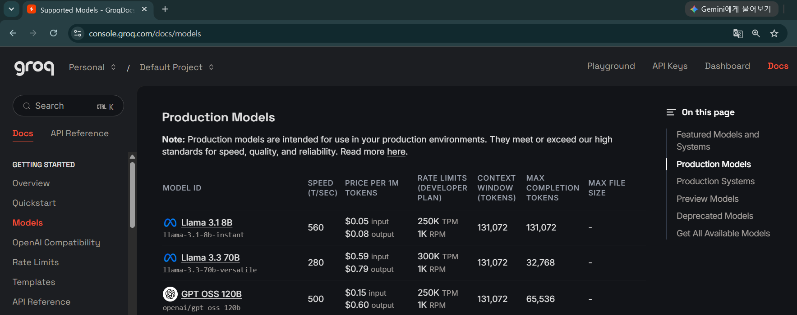
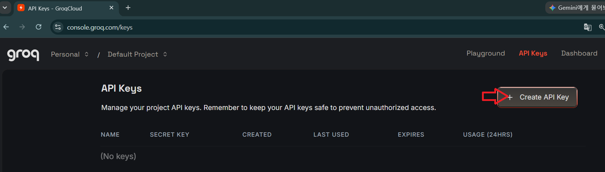
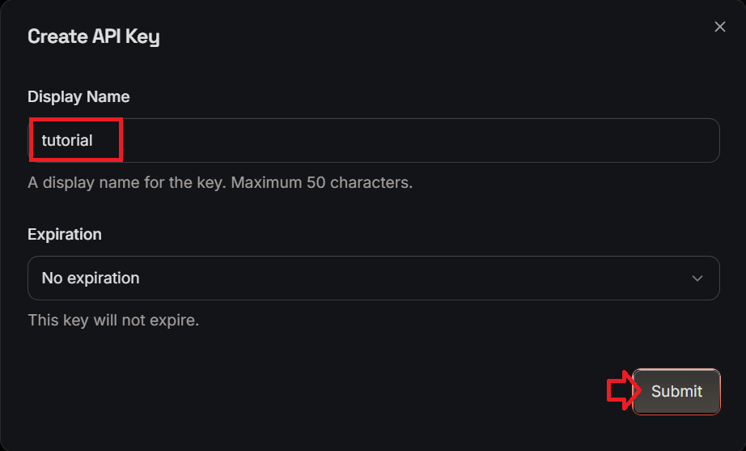
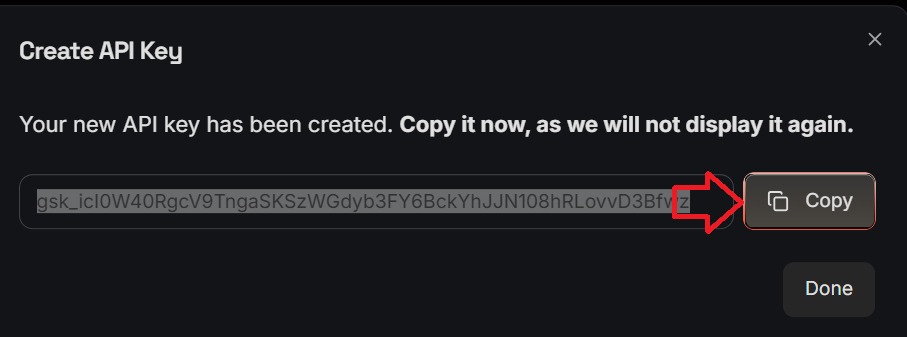
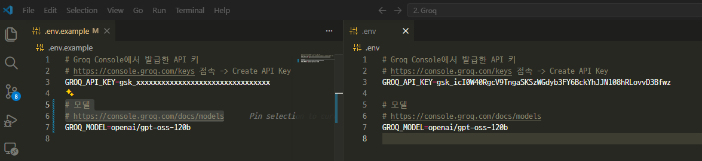
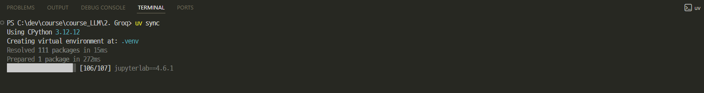

# [Groq이란](https://groq.com/)
> Groq은 AI 모델을 매우 빠르게 추론(Inference)하기 위한 AI 반도체와 클라우드 서비스를 제공하는 회사입니다.

"LLM을 매우 빠른 속도로 실행하기 위한 AI 추론(Inference) 플랫폼" 입니다.


---
## 왜 유명해졌을까?
- Groq의 가장 큰 장점은 압도적인 추론 속도입니다.
- 예를 들어 같은 모델이라도
    - GPU에서 100 token/sec
    - Groq에서는 500~1000 token/sec

처럼 훨씬 빠르게 생성되는 경우가 많습니다. (모델에 따라 차이가 있음)

---
# Groq 서비스 
- `OpenAI(ChatGPT)`: 모델을 만드는 회사
- `Groq`: 모델을 매우 빠르게 실행하는 회사

---
## LPU(Language Processing Unit)
- Groq가 직접 설계한 AI 칩입니다.
- 특징
    - Transformer 연산 최적화
    - 매우 낮은 지연시간(Low Latency)
    - 높은 처리량(Throughput)
    - 추론 전용(Inference)

> 학습(Training)이 아니라 실행(Inference)에 특화된 칩입니다.

---
### GPU와 무엇이 다른가?

| 구분            | GPU (NVIDIA) | Groq LPU         |
| ------------- | ------------ | ---------------- |
| 목적            | 학습 + 추론      | 추론(Inference) 전용 |
| 응답속도          | 빠름           | 매우 빠름            |
| 지연시간(Latency) | 비교적 높음       | 매우 낮음            |
| 처리량           | 높음           | 매우 높음            |
| 비용            | 상대적으로 비쌈     | 저렴한 편            |
| 학습 가능         | ✅            | ❌                |

---
## GroqCloud
- OpenAI API처럼 사용할 수 있는 API 서비스입니다.

```python
from groq import Groq

client = Groq(api_key="YOUR_API_KEY")

response = client.chat.completions.create(
    model="llama-3.3-70b-versatile",
    messages=[
        {"role":"user","content":"Hello"}
    ]
)

print(response.choices[0].message.content)
```

---
### [Models](https://console.groq.com/docs/models)
> Groq의 정책에 따라 사용가능한 모델들은 변경될 수 있습니다.



---
| 모델 | 특징 | 수업 사용 |
| --- | --- | --- |
| `llama-3.1-8b-instant` | 매우 빠르고 저렴한 기본 모델 | 기본 실습 권장 |
| `llama-3.3-70b-versatile` | 품질이 더 좋은 범용 모델 | 품질 비교 |
| `openai/gpt-oss-20b` | 빠른 GPT-OSS 모델 | 오픈 가중치 계열 비교 |
| `openai/gpt-oss-120b` | 더 큰 GPT-OSS 모델 | 추론 품질 비교 |
| `whisper-large-v3-turbo` | 음성 인식 | STT 확장 수업 |

> 실제 사용 가능 모델은 계정, 프로젝트 권한, 모델 상태에 따라 달라질 수 있습니다.

---
### Groq vs 다른 LLMs
> Groq는 자체 LLM을 만드는 회사라기보다, 다양한 공개·오픈 모델을 매우 빠르게 서빙하는 추론 플랫폼으로 이해하면 좋습니다.

| 항목 | Groq | OpenAI | Google GenAI | Ollama |
| --- | ---: | ---: | ---: | ---: |
| 인터넷 필요 | 필요 | 필요 | 필요 | 불필요 |
| 속도 | 매우 빠름 | 빠름 | 빠름 | PC 성능 의존 |
| 비용 | 사용량 기반 | 사용량 기반 | 사용량 기반 | 무료 |
| 강점 | 저지연, 스트리밍, 오픈 모델 | 품질, 도구 생태계 | 멀티모달, 긴 문맥 | 로컬 실행 |

---
# [Groq 요금](https://groq.com/pricing) 

---
## Free Tier
> 무료 플랜은 개인 개발자나 학습용으로 매우 넉넉한 편입니다.

| 항목      | 내용                       |
| ------- | ------------------------ |
| 가격      | **무료 ($0)**              |
| 신용카드    | 필요 없음                  |
| API Key | 무료 발급                    |
| 지원 모델   | 대부분의 공개 모델 사용 가능         |
| 과금      | 없음                       |
| 제한      | Rate Limit(요청 수/토큰 수) 적용 |

---
## Developer Tier
> 운영 서비스나 대량 호출이 필요하면 Developer Tier를 사용합니다.

| 항목         | 내용                     |
| ---------- | ---------------------- |
| 과금 방식      | Pay-as-you-go (사용량 기반) |
| 신용카드       | 필요                   |
| 월 기본요금     | 없음                     |
| 최소 사용료     | 없음                     |
| Rate Limit | Free 대비 최대 약 10배       |
| Batch API  | 지원 (일부 작업은 할인 제공)      |

---
## OpenAI와 비교

| 항목         | Groq   | OpenAI            |
| ---------- | ------ | ----------------- |
| 무료 API     | 가능   | 일반적으로 무료 API 없음 |
| 신용카드 없이 시작 | ✅      | ❌                 |
| 월 기본요금     | 없음     | 없음                |
| 과금 방식      | 사용량 기반 | 사용량 기반            |
| 주요 강점      | 초고속 추론 | 자체 최신 모델(GPT 시리즈) |


---
# 개발 환경 구축

---
## [API 키 발급](https://console.groq.com/keys)



---
> API Key는 Groq을 사용할 수 있는 권한을 증명하는 인증 키입니다.



---
> 생성된 키를 한 번만 복사해서 `.env`에 저장
> API 키는 절대 코드나 노트북 출력에 직접 남기지 않습니다.



---
## 환경변수 설정

`.env.example`을 복사해서 `.env` 파일을 만들고 값을 채웁니다.



---
### `.env` 예시

```env
GROQ_API_KEY=gsk_xxxxxxxxxxxxxxxxxxxxxxxxxxxxxxxx
GROQ_MODEL=llama-3.1-8b-instant
```

```python
import os
from dotenv import load_dotenv

load_dotenv()
api_key = os.environ["GROQ_API_KEY"]
model = os.environ.get("GROQ_MODEL", "llama-3.1-8b-instant")
```

---
## SDK 설치

```bash
pip install groq python-dotenv tiktoken
```

uv를 사용한다면 다음처럼 설치합니다.

```bash
uv sync
```


---
## 주요 패키지 구조

```text
groq
├── Groq                         <- 메인 클라이언트
├── client.chat.completions      <- Chat Completions API
├── choices[0].message.content   <- 가장 자주 쓰는 텍스트 결과
└── usage                        <- 토큰 사용량
```

---
### API 호출

```python
import os
from dotenv import load_dotenv
from groq import Groq

load_dotenv()

client = Groq(api_key=os.environ["GROQ_API_KEY"])
model = os.environ.get("GROQ_MODEL", "llama-3.1-8b-instant")

chat_completion = client.chat.completions.create(
    model=model,
    messages=[
        {"role": "user", "content": "Python에서 리스트가 무엇인지 설명해줘."}
    ],
)

print(chat_completion.choices[0].message.content)
```

---
### 메시지 역할

Groq Chat Completions는 OpenAI Chat Completions와 비슷한 메시지 배열을 사용합니다.

| 역할 | 의미 | 예시 |
| --- | --- | --- |
| `system` | 모델의 행동 방식, 말투, 규칙 | "친절한 Python 선생님처럼 답하세요" |
| `user` | 사용자의 질문이나 요청 | "리스트가 뭐야?" |
| `assistant` | 이전 모델 답변 | 멀티턴 대화 기록 |

---
> 시스템 메시지 예시

```python
chat_completion = client.chat.completions.create(
    model=model,
    messages=[
        {
            "role": "system",
            "content": "당신은 친절한 한국어 Python 선생님입니다.",
        },
        {
            "role": "user",
            "content": "함수와 메서드의 차이를 설명해줘.",
        },
    ],
)

print(chat_completion.choices[0].message.content)
```

---
### 응답 구조 분석

```python
response = client.chat.completions.create(...)

message = response.choices[0].message
print(message.role)
print(message.content)

usage = response.usage
print(f"입력 토큰: {usage.prompt_tokens}")
print(f"출력 토큰: {usage.completion_tokens}")
print(f"총 토큰:   {usage.total_tokens}")
```

---
> 응답 전체 구조

```text
ChatCompletion
├── id
├── model
├── choices[]
│   └── message
│       ├── role
│       └── content
└── usage
    ├── prompt_tokens
    ├── completion_tokens
    └── total_tokens
```

---
### 파라미터

| 파라미터 | 의미 |
| --- | --- |
| `temperature` | 낮을수록 안정적, 높을수록 다양함 |
| `top_p` | 후보 토큰 범위 조절 |
| `max_completion_tokens` | 출력 토큰 상한 |
| `stop` | 특정 문자열에서 생성 중단 |
| `stream` | 토큰 단위 스트리밍 |

---
> 파라미터 예시 

```python
response = client.chat.completions.create(
    model=model,
    messages=[{"role": "user", "content": "API 비용을 줄이는 법을 알려줘."}],
    temperature=0.5,
    top_p=1,
    max_completion_tokens=300,
    stop=None,
)
```

---
### 스트리밍 응답

```python
stream = client.chat.completions.create(
    model=model,
    messages=[
        {"role": "user", "content": "스트리밍이 필요한 이유를 3가지로 설명해줘."}
    ],
    stream=True,
)

for chunk in stream:
    print(chunk.choices[0].delta.content or "", end="")
```

---
### 싱글턴 vs 멀티턴
- `싱글턴(Single-turn)` : 이전 대화를 기억하지 않는 독립적인 요청
- `멀티턴(Multi-turn)` : 이전 대화를 기억하여 이어서 대화하는 방식

---
| 구분         | 싱글턴 (Single-turn) | 멀티턴 (Multi-turn) |
| ---------- | ----------------- | ---------------- |
| 대화 기억      | ❌              | ✅             |
| 이전 질문 참조   | 불가능               | 가능               |
| Context 유지 | ❌                 | ✅                |
| 구현 난이도     | 쉬움                | 상대적으로 복잡         |
| 토큰 사용량     | 적음                | 많아질 수 있음         |
| 활용         | FAQ, 번역, 요약       | 챗봇, AI 비서, 상담    |


---
> 싱글턴 호출

```python
client.chat.completions.create(
    model=model,
    messages=[{"role": "user", "content": "파이썬이 뭐야?"}],
)
```

각 요청은 독립적입니다.

---
> 멀티턴 호출

```python
messages = [
    {"role": "user", "content": "파이썬이 뭐야?"},
    {"role": "assistant", "content": "파이썬은 읽기 쉬운 프로그래밍 언어입니다."},
    {"role": "user", "content": "방금 말한 것보다 더 쉽게 설명해줘."},
]

client.chat.completions.create(
    model=model,
    messages=messages,
)
```

Groq는 메시지 목록에 이전 대화를 직접 넣어 대화를 이어갑니다.

---
### 에러 처리

```python
try:
    response = client.chat.completions.create(
        model=model,
        messages=[{"role": "user", "content": user_input}],
    )
    print(response.choices[0].message.content)
except Exception as e:
    status_code = getattr(e, "status_code", None)
    print(f"Groq API 오류: {status_code} {e}")
```

---
> 주요 에러 상황

| 코드 | 의미 | 대처 |
| --- | --- | --- |
| 400 | 요청 형식 오류 | 메시지 구조, 파라미터 확인 |
| 401 | 인증 실패 | API 키 확인 |
| 403 | 권한 없음 | 모델 권한, 프로젝트 권한 확인 |
| 413 | 요청 본문이 너무 큼 | 입력 길이 줄이기 |
| 422 | 처리할 수 없는 요청 | 입력·출력 형식 확인 후 재시도 |
| 429 | 요청 한도 초과 | 잠시 대기, 호출 횟수 줄이기 |
| 500/502/503 | 서버 측 오류 | 잠시 후 재시도 |

