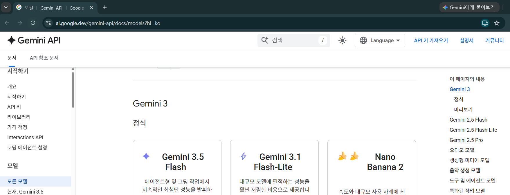
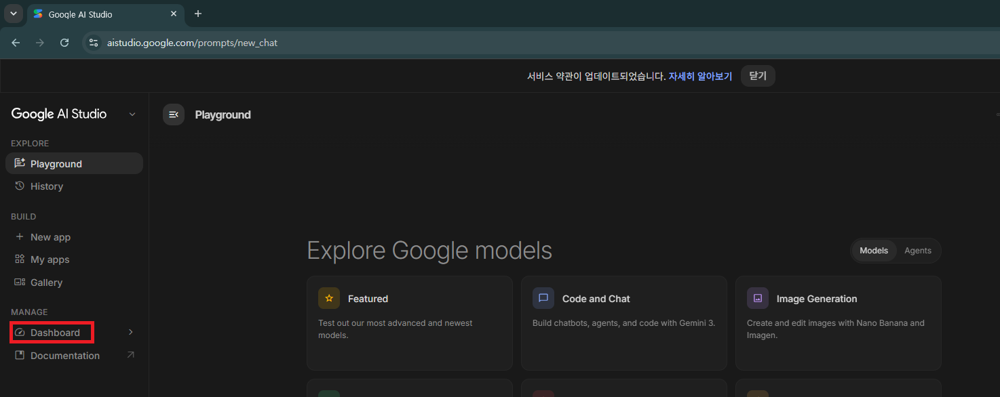
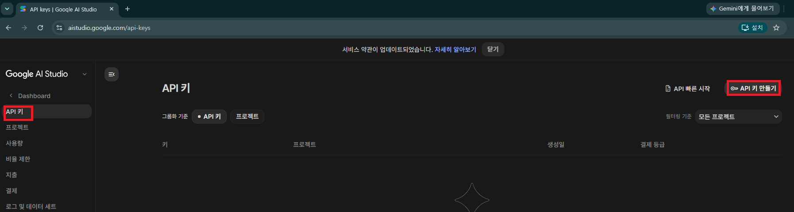
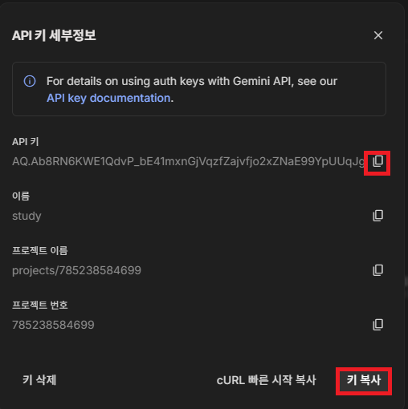
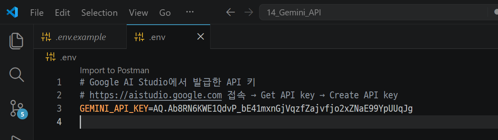
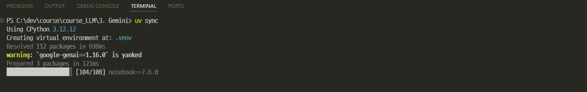

# [Google Gemini](https://gemini.google.com/app?hl=ko)
> Gemini는 Google이 개발한 생성형 AI 모델(LLM) 및 AI 플랫폼입니다. 
> 텍스트뿐만 아니라 이미지, 음성, 영상, 코드까지 이해하고 생성할 수 있는 멀티모달(Multimodal) AI를 목표로 만들어졌습니다.

---
## Gemini를 사용할 수 있는 곳
| 서비스                                          | 설명                                                                                                               |
| -------------------------------------------- | ---------------------------------------------------------------------------------------------------------------- |
| **Gemini 웹 서비스**                             | AI 챗봇 사용                                  |
| **Android의 Gemini Assistant**                | 스마트폰에 탑재되는 스마트폰 AI 비서                                |
| **Google Workspace (Docs, Gmail, Sheets 등)** | Gmail·Docs 등에 AI 기능 제공       |
| **Google AI Studio**                         | 개발자가 Gemini를 테스트하는 곳                   |
| **Vertex AI**                                | 기업용 AI 개발 및 운영 플랫폼 |
| **Gemini API**                               | 프로그램에서 Gemini를 호출하는 인터페이스    |

---
> 쉽게 이해하면
```
일반 사용자
    │
    ├── Gemini 웹 서비스
    ├── Android Gemini Assistant
    └── Google Workspace

개발자
    │
    ├── Google AI Studio (테스트 및 API 키 발급)
    └── Gemini API (프로그램 연동)

기업
    │
    └── Vertex AI (대규모 AI 서비스 구축)
```

---
## Google Gemini vs 다른 LLMs

| 항목         | Google Gemini |                  Groq |             Ollama |
| ---------- | -----------: | --------------------: | -----------------: |
| 운영 위치      | Google Cloud |            Groq Cloud |              내 컴퓨터 |
| 인터넷 필요     |            필요 |                     필요 |                  불필요 |
| 속도         |           빠름 |             **매우 빠름** |           PC 성능 의존 |
| 비용         |       사용량 기반 |                사용량 기반 |        무료 (전기세 제외) |
| 개인정보 보호    |    Google 서버 |               Groq 서버 |             **최고** |
| 멀티모달       |        ★★★★★ |                 ★★☆☆☆ |              ★★☆☆☆ |
| 장문 처리      |        ★★★★★ |                 ★★★☆☆ |              ★★★☆☆ |
| Agent 개발   |        ★★★★☆ |                 ★★★★★ |              ★★★☆☆ |

---
## [Gemini Models](https://ai.google.dev/gemini-api/docs/models?hl=ko)



---
# [Google AI Studio](https://aistudio.google.com/prompts/new_chat)
> 개발자가 Gemini 모델을 무료 또는 제한된 범위에서 테스트하고 프롬프트를 실험할 수 있는 웹 기반 개발 환경입니다. 
> API 키 발급 및 샘플 코드 확인도 가능합니다.

---
- `Gemini`: AI 모델
- `Google AI Studio`: Gemini API를 테스트하고 사용할 수 있는 개발자 플랫폼
- `google-genai SDK`: Google이 제공하는 공식 개발 라이브러리(SDK)

```
Google AI Studio: API Key 발급 
      ↓
내 프로그램
      ↓
google-genai SDK
      ↓
Gemini API
      ↓
Gemini (AI 모델)
```

---
## 1. API 키 발급 (무료)

---
### [Google AI Studio 접속](https://aistudio.google.com/prompts/new_chat)



---
> API Key 만들기 



---
> API Key 생성


---
### 환경변수 설정
> 생성한 키 복사하기



---
> API 키는 절대 코드에 직접 넣지 않습니다. 
> `.env.sample`을 통해 `.env` 파일 생성 후 저장합니다.



---
> 파이썬 코드를 통해 생성한 키 적용하기 

```python
# Python에서 로드
import os
from dotenv import load_dotenv

load_dotenv()
api_key = os.environ["GEMINI_API_KEY"]
```

---
## 2. SDK 설치
```bash
pip install openai python-dotenv tiktoken
```

uv를 사용한다면 다음처럼 설치합니다.

```bash
uv sync
```


---
### 주요 패키지 구조

```
google-genai
├── google.genai.Client          ← 메인 클라이언트
├── google.genai.types           ← 설정 타입 (GenerateContentConfig)
└── google.genai.errors          ← 에러 클래스
```

> `google-generativeai` (구 SDK)와 다릅니다. 반드시 `google-genai`를 사용하세요.

---
## 3. 첫 API 호출

```python
import os
from dotenv import load_dotenv
from google import genai

load_dotenv()
client = genai.Client(api_key=os.environ["GEMINI_API_KEY"])

response = client.models.generate_content(
    model="gemini-3.5-flash",
    contents="Python이란 무엇인가요?",
)
print(response.text)
```

---
## 4. 응답 구조 분석

---
### Response 객체

```python
response = client.models.generate_content(...)

# 텍스트 결과
print(response.text)

# 토큰 사용량
usage = response.usage_metadata
print(f"입력 토큰: {usage.prompt_token_count}")
print(f"출력 토큰: {usage.candidates_token_count}")
print(f"총 토큰:   {usage.total_token_count}")

# 상세 구조 (중단 이유 등)
candidate = response.candidates[0]
print(f"중단 이유: {candidate.finish_reason}")
```

---
### 응답 전체 구조

```
GenerateContentResponse
├── text                          ← 가장 자주 사용
├── usage_metadata
│   ├── prompt_token_count        ← 입력 토큰
│   ├── candidates_token_count    ← 출력 토큰
│   └── total_token_count
└── candidates[]
    └── content
        └── parts[]
            └── text              ← response.text와 동일
```

---
## 5. 시스템 지시문 (System Instruction)

모델의 역할이나 행동 방식을 미리 정의합니다.

```python
from google.genai import types

response = client.models.generate_content(
    model="gemini-3.5-flash",
    contents="오늘 기분이 어때?",
    config=types.GenerateContentConfig(
        system_instruction="당신은 항상 시로 답하는 시인입니다. "
                           "모든 답변을 3행시 형식으로 작성하세요.",
    ),
)
print(response.text)
```

---
## 6. 토큰 사전 카운팅

API 호출 전에 토큰 수를 미리 확인할 수 있습니다.

```python
token_response = client.models.count_tokens(
    model="gemini-3.5-flash",
    contents="이 텍스트는 몇 토큰일까요?",
)
print(f"예상 토큰: {token_response.total_tokens}")
```

---
## 7. 에러 처리

```python
from google.genai import errors

try:
    response = client.models.generate_content(
        model="gemini-3.5-flash",
        contents=user_input,
    )
    return response.text

except errors.APIError as e:
    message = e.message or str(e)
    print(f"  APIError [{e.code} {e.status}]: {message[:100]}")

except Exception as e:
    print(f"예상치 못한 에러: {e}")
```

---
### 주요 에러 코드

| 코드 | 의미 | 대처 |
|------|------|------|
| 400 | 잘못된 요청 (API 키 형식 오류 등) | 요청 파라미터 확인 |
| 403 | 인증 실패 | API 키 확인 |
| 429 | 요청 한도 초과 | 잠시 대기 후 재시도 |
| 500 | 서버 내부 오류 | 재시도 |

---
## 8. 사용 가능한 모델 목록 조회

```python
for model in client.models.list():
    print(model.name)
```

> 추천 모델 (2026년 기준)

| 모델 | 특징 | 무료 |
|------|------|------|
| `gemini-3.5-flash` | 안정 모델, 속도와 지능의 균형 | O |
| `gemini-3.1-flash-lite` | 고빈도·경량 작업에 유리 | O |
| `gemini-3.1-pro-preview` | 복잡한 추론·코딩 작업 | X |
| `gemini-2.5-flash` | 이전 세대 Flash, 추론 지원 | O (제한) |
