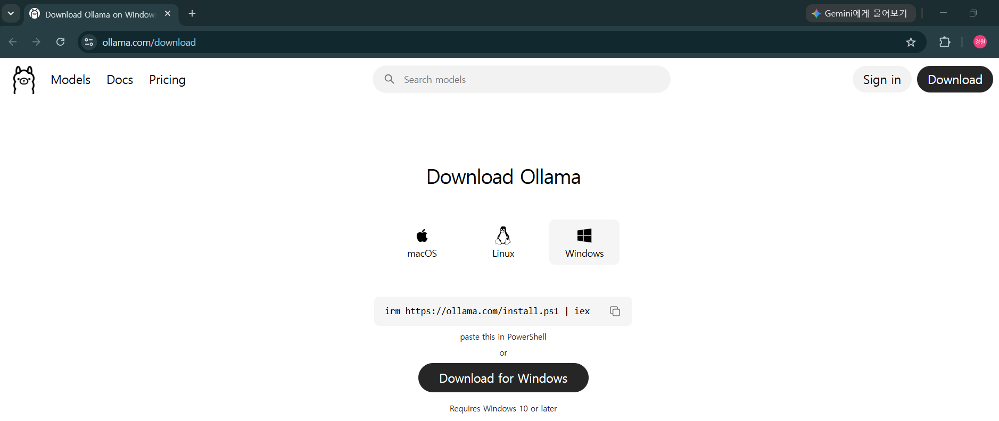
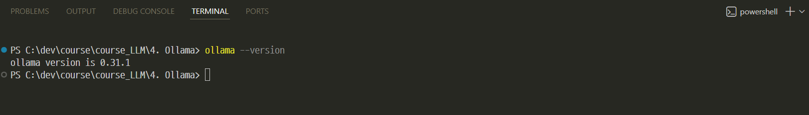
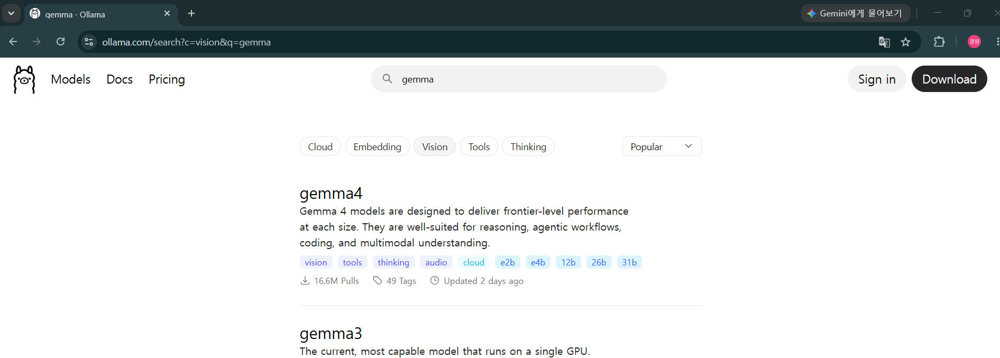
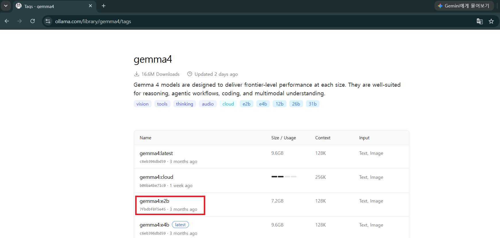
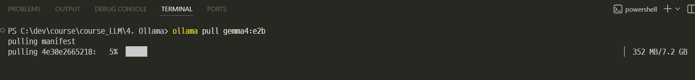
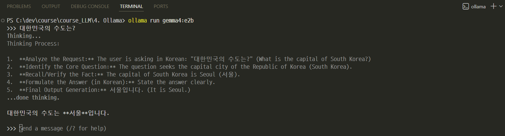
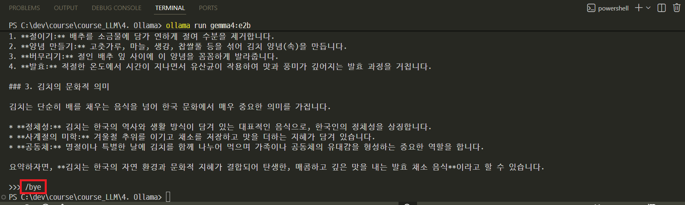
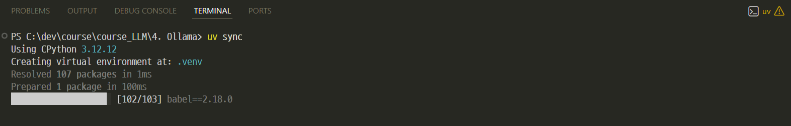
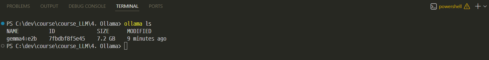

# [Ollama란](https://ollama.com/)
> Ollama는 오픈소스/오픈웨이트 LLM을 내 컴퓨터에서 내려받아 실행하고, CLI와 로컬 API로 호출할 수 있게 해주는 로컬 LLM 런타임입니다.

클라우드 API처럼 프로그램에서 요청을 보내고 응답을 받지만, 모델이 실행되는 위치가 OpenAI 서버가 아니라 `내 컴퓨터`라는 점이 가장 큰 차이입니다.

---
## Ollama가 제공하는 주요 기능

| 기능 | 설명 | 활용 예시 |
| --- | --- | --- |
| Model Library | 다양한 로컬 모델 다운로드 | `gemma3`, `llama3.2`, `qwen3` |
| CLI | 모델 실행과 관리 | `run`, `pull`, `ls`, `ps`, `stop`, `rm` |
| Local REST API | HTTP로 로컬 모델 호출 | 챗봇, 실험용 백엔드 |
| Python SDK | Python 코드에서 모델 호출 | 노트북 실습, 앱 개발 |
| Streaming | 응답을 토큰 단위로 출력 | 실시간 채팅 UI |
| Modelfile | 모델의 기본 지시문과 파라미터 설정 | Python 튜터 모델 만들기 |
| GGUF 연동 | Hugging Face GGUF 모델 실행 | 양자화 모델 실험 |

---
## Ollama vs 다른 LLMs

| 항목 | Ollama | OpenAI | Google GenAI | Groq |
| --- | ---: | ---: | ---: | ---: |
| 운영 위치 | 내 컴퓨터 | OpenAI Cloud | Google Cloud | Groq Cloud |
| 인터넷 필요 | 모델 다운로드 후 불필요 | 필요 | 필요 | 필요 |
| 속도 | PC 성능 의존 | 빠름 | 빠름 | 매우 빠름 |
| 비용 | 무료 | 사용량 기반 | 사용량 기반 | 사용량 기반 |
| 개인정보 보호 | 로컬 보관 | OpenAI 서버 | Google 서버 | Groq 서버 |
| 오프라인 실습 | 가능 | 불가능 | 불가능 | 불가능 |

---
# [Ollama API란](https://docs.ollama.com/api)
> Ollama API는 내 컴퓨터에서 실행 중인 Ollama 서버에 HTTP 요청을 보내 로컬 LLM을 호출하는 API입니다.

쉽게 말해, OpenAI API처럼 `HTTP API로 모델을 호출`하지만 요청 주소가 `http://localhost:11434`이고 모델 실행도 로컬에서 일어납니다.

---
## 동작 구조

```text
┌──────────────┐
│ 내 프로그램   │
└──────┬───────┘
       │ HTTP 요청
       ▼
┌──────────────────────┐
│ Ollama Local API      │
│ localhost:11434       │
└──────┬───────────────┘
       ▼
┌──────────────────────┐
│ 로컬 모델             │
│ gemma3, llama3.2 등   │
└──────┬───────────────┘
       ▼
┌──────────────────────┐
│ 내 PC의 CPU/GPU/RAM   │
└──────────────────────┘
```

---
## 사용 흐름

| 단계 | 작업 | 대표 명령 |
| --- | --- | --- |
| 1 | Ollama 설치 | `ollama --version` |
| 2 | 모델 다운로드 | `ollama pull gemma3:1b` |
| 3 | 터미널에서 실행 | `ollama run gemma3:1b` |
| 4 | 로컬 API 확인 | `http://localhost:11434/api` |
| 5 | Python SDK 호출 | `client.chat(...)` |
| 6 | 모델 커스터마이징 | `ollama create python-tutor -f Modelfile` |

---
# 개발 환경 구축

---
## [Ollama 설치](https://ollama.com/download)
> Ollama는 macOS, Windows, Linux에서 사용할 수 있습니다.



---
### 설치 확인:

```bash
ollama --version
```


---
## [Ollama 모델 검색](https://ollama.com/search?c=vision&q=gemma)
> Ollama Library에서 사용할 모델을 검색할 수 있습니다.



---
> [gemma4](https://ollama.com/library/gemma4/tags)



---
## 모델 다운로드 및 실행
> 모델 다운로드 
```bash
ollama pull gemma4:e2b
```


---
> 모델 실행 
```bash
ollama run gemma4:e2b
```


---
> 대화를 종료하려면 다음을 입력합니다.
```text
/bye
```


---
## 모델 관리 명령

```bash
# 모델 다운로드
ollama pull gemma4:e2b

# 모델 실행
ollama run gemma4:e2b

# 설치된 모델 목록
ollama ls

# 실행 중인 모델 목록
ollama ps

# 실행 중인 모델 중지
ollama stop gemma4:e2b

# 설치된 모델 삭제
ollama rm gemma4:e2b
```

---
## 환경변수 설정

`.env.example`을 복사해서 `.env` 파일을 만들고 값을 채웁니다.

```env
OLLAMA_HOST=http://localhost:11434
OLLAMA_MODEL=gemma4:e2b
```

```python
import os
from dotenv import load_dotenv

load_dotenv()
host = os.environ.get("OLLAMA_HOST", "http://localhost:11434")
model = os.environ.get("OLLAMA_MODEL", "gemma4:e2b")
```

---
## SDK 설치

```bash
pip install ollama python-dotenv requests
```

uv를 사용한다면 다음처럼 설치합니다.

```bash
uv sync
```



---
## 주요 패키지 구조

```text
ollama
├── Client                  <- 호스트를 지정하는 클라이언트
├── client.chat             <- 대화형 모델 호출
├── client.generate         <- 단일 프롬프트 생성
├── client.list             <- 설치된 모델 목록
├── client.pull             <- 모델 다운로드
└── ChatResponse            <- 응답 객체
```

---
### Python SDK API 호출

`gemma4`처럼 생각 과정을 지원하는 모델은 수업 화면에 답변 본문이 바로 보이도록 `think=False`를 함께 사용합니다.

```python
import os
from dotenv import load_dotenv
from ollama import Client

load_dotenv()

client = Client(host=os.environ.get("OLLAMA_HOST", "http://localhost:11434"))
model = os.environ.get("OLLAMA_MODEL", "gemma3:1b")

response = client.chat(
    model=model,
    think=False,
    messages=[
        {"role": "user", "content": "Python 변수를 한 문장으로 설명해줘."},
    ],
)

print(response.message.content)
```

---
### REST API 호출

```bash
curl http://localhost:11434/api/chat -d '{
  "model": "gemma3:1b",
  "messages": [
    {"role": "user", "content": "Python 변수를 한 문장으로 설명해줘."}
  ],
  "stream": false,
  "think": false
}'
```

로컬 서버에 직접 HTTP 요청을 보내므로 웹 애플리케이션이나 백엔드에서도 같은 방식으로 사용할 수 있습니다.

---
### 응답 구조 분석

```python
response = client.chat(...)

print(response.model)
print(response.message.role)
print(response.message.content)
print(response.done)
print(response.prompt_eval_count)
print(response.eval_count)
print(response.total_duration)
```

---
> 응답 전체 구조

```text
ChatResponse
├── model
├── message
│   ├── role
│   └── content                 <- 가장 자주 쓰는 텍스트 결과
├── done
├── prompt_eval_count           <- 입력 평가 토큰 수
├── eval_count                  <- 출력 평가 토큰 수
└── total_duration              <- 전체 처리 시간
```

---
### 지시문 사용

모델에게 역할, 말투, 출력 형식을 미리 알려줄 때 `system` 역할을 사용합니다.

```python
response = client.chat(
    model=model,
    think=False,
    messages=[
        {
            "role": "system",
            "content": (
                "당신은 친절한 한국어 Python 선생님입니다. "
                "답변은 쉬운 비유 1개와 코드 1개로 구성하세요."
            ),
        },
        {"role": "user", "content": "리스트가 무엇인지 설명해줘."},
    ],
)

print(response.message.content)
```

---
### 메시지 배열로 역할 나누기

복잡한 대화에서는 `system`, `user`, `assistant` 역할을 직접 배열로 구성합니다.

```python
messages = [
    {
        "role": "system",
        "content": "답변은 초보자용으로 작성하고, 마지막에 확인 질문 1개를 붙입니다.",
    },
    {"role": "user", "content": "함수와 메서드의 차이를 알려줘."},
]

response = client.chat(model=model, think=False, messages=messages)
print(response.message.content)
```

---
### 제어 파라미터

Ollama의 생성 옵션은 `options` 안에 넣습니다.

```python
response = client.chat(
    model=model,
    think=False,
    messages=[{"role": "user", "content": "함수를 설명해줘."}],
    options={
        "temperature": 0.7,
        "top_p": 0.9,
        "num_predict": 200,
        "stop": ["---끝---"],
    },
)

print(response.message.content)
```

---
> 주요 옵션

| 옵션 | 의미 |
| --- | --- |
| `temperature` | 높을수록 창의적, 낮을수록 안정적 |
| `top_p` | 후보 토큰 범위 조절 |
| `top_k` | 후보 토큰 개수 제한 |
| `num_predict` | 최대 출력 토큰 수 |
| `num_ctx` | 컨텍스트 창 크기 |
| `repeat_penalty` | 반복 억제 강도 |
| `seed` | 같은 입력에 대한 재현성 |
| `stop` | 특정 문자열에서 생성 중단 |

---
### 토큰과 시간 확인

Ollama 응답에는 로컬 모델이 처리한 입력/출력 평가 개수와 처리 시간이 포함됩니다.

```python
response = client.chat(
    model=model,
    think=False,
    messages=[{"role": "user", "content": "토큰은 왜 중요한가요?"}],
)

print(f"입력 평가 토큰: {response.prompt_eval_count}")
print(f"출력 평가 토큰: {response.eval_count}")
print(f"전체 처리 시간: {response.total_duration}")
```

---
### 에러 처리

```python
from ollama import ResponseError

try:
    response = client.chat(
        model=model,
        think=False,
        messages=[{"role": "user", "content": user_input}],
    )
    print(response.message.content)

except ResponseError as e:
    print(f"Ollama 응답 오류: {e.error}")

except Exception as e:
    print(f"Ollama 서버 실행 여부와 모델 이름을 확인하세요: {e}")
```

---
> 주요 에러 상황

| 상황 | 자주 보는 원인 | 대처 |
| --- | --- | --- |
| 연결 실패 | Ollama 서버가 꺼져 있음 | Ollama 앱 또는 `ollama serve` 실행 |
| 모델 없음 | 모델을 아직 다운로드하지 않음 | `ollama pull gemma3:1b` |
| 응답이 매우 느림 | PC RAM/VRAM 부족, 큰 모델 사용 | 더 작은 모델 선택 |
| 메모리 오류 | 모델 크기가 PC 사양보다 큼 | `gemma3:270m`, `gemma3:1b` 사용 |
| REST 호출 실패 | JSON 따옴표나 쉘 차이 | Python SDK로 먼저 확인 |

---
### 사용 가능한 모델 목록 조회

```python
models = client.list()

for item in models.models:
    print(item.model)
```

터미널에서는 다음 명령을 사용할 수 있습니다.

```bash
ollama ls
```


---
### 싱글턴 vs 멀티턴

- `싱글턴(Single-turn)` : 이전 대화를 기억하지 않는 독립적인 요청
- `멀티턴(Multi-turn)` : 이전 메시지 목록을 함께 보내 대화를 이어가는 방식

---
| 구분 | 싱글턴 (Single-turn) | 멀티턴 (Multi-turn) |
| --- | --- | --- |
| 대화 기억 | ❌ | ✅ |
| 이전 질문 참조 | 불가능 | 가능 |
| Context 유지 | ❌ | ✅ |
| 구현 난이도 | 쉬움 | 메시지 목록 관리 필요 |
| 토큰 사용량 | 적음 | 많아질 수 있음 |
| 활용 | FAQ, 번역, 요약 | 챗봇, AI 비서, 상담 |

---
> 싱글턴 호출

```python
client.chat(
    model=model,
    think=False,
    messages=[{"role": "user", "content": "파이썬이 뭐야? 한 문장으로 답해줘."}],
)
```

각 요청이 독립적입니다.

---
> 멀티턴 호출

```python
messages = [
    {"role": "user", "content": "파이썬이 뭐야? 한 문장으로 답해줘."},
]

first = client.chat(model=model, think=False, messages=messages)
messages.append({"role": "assistant", "content": first.message.content})
messages.append({"role": "user", "content": "방금 말한 것보다 더 쉽게 설명해줘."})

second = client.chat(model=model, think=False, messages=messages)
print(second.message.content)
```

Ollama는 OpenAI의 `previous_response_id`처럼 서버에 대화 상태를 맡기지 않고, `messages` 배열에 이전 대화를 직접 넣어 이어갑니다.

---
### 스트리밍

Python SDK에서는 `stream=True`로 응답을 실시간 출력할 수 있습니다.

```python
stream = client.chat(
    model=model,
    think=False,
    messages=[{"role": "user", "content": "스트리밍이 왜 유용한지 설명해줘."}],
    stream=True,
)

for chunk in stream:
    print(chunk.message.content or "", end="", flush=True)
```
