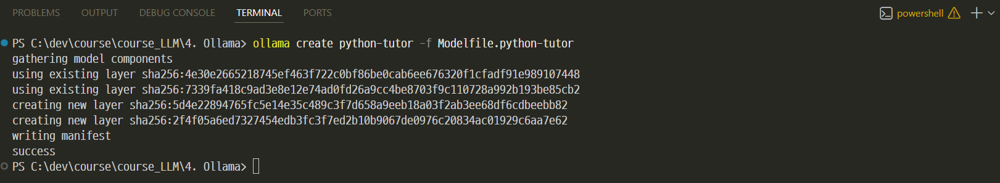
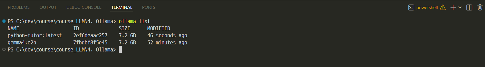
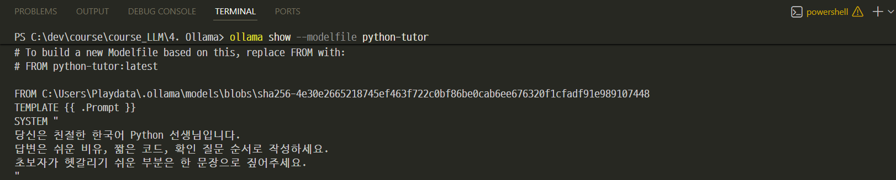
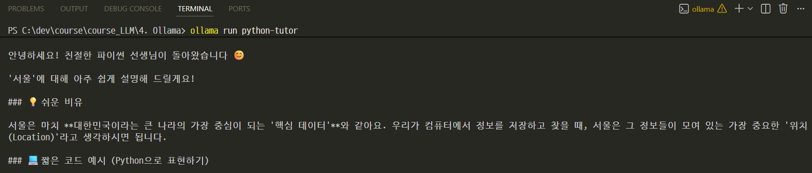
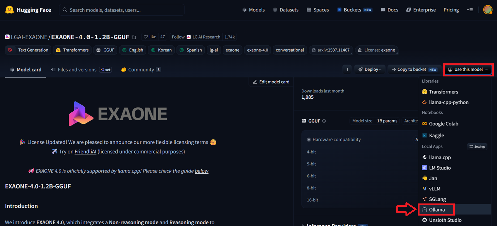
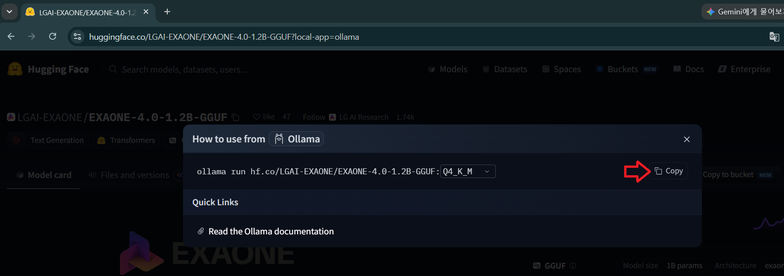
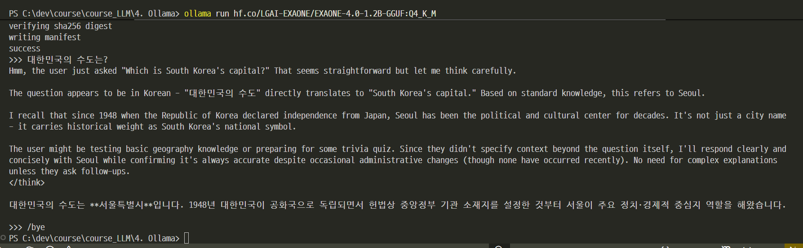

# Modelfile

---
## Modelfile이란

`Modelfile`은 모델을 커스터마이징하기 위한 설계도입니다.

```text
FROM gemma4:e2b
PARAMETER temperature 0.7
PARAMETER top_p 0.9
PARAMETER num_ctx 4096
SYSTEM """
당신은 친절한 한국어 Python 선생님입니다.
답변은 쉬운 비유, 짧은 코드, 확인 질문 순서로 작성하세요.
"""
```

---
## 커스텀 모델 만들기

이 폴더의 `Modelfile.python-tutor`를 사용해 수업용 모델을 만들 수 있습니다.

```bash
ollama create python-tutor -f Modelfile.python-tutor
```


---
> 생성된 모델 확인 
```bash
ollama list
```


---
> 생성된 모델의 Modelfile을 확인할 수도 있습니다.
```bash
ollama show --modelfile python-tutor
```


---
> 생성된 모델 실행 
```bash
ollama run python-tutor
```


---
## Hugging Face GGUF 모델 사용

Hugging Face의 GGUF 모델도 Ollama에서 실행할 수 있습니다.

```bash
ollama run hf.co/{username}/{repository}:{quantization}
```

---
### [예시: EXAONE-4.0-1.2B-GGUF](https://huggingface.co/LGAI-EXAONE/EXAONE-4.0-1.2B-GGUF)



---
> 명령어 복사 



---
> 명령어를 통해 모델 다운로드 및 실행 


