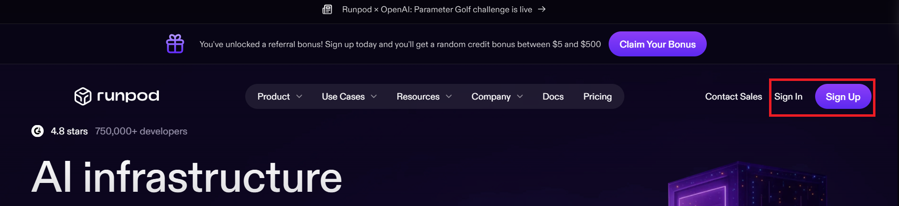
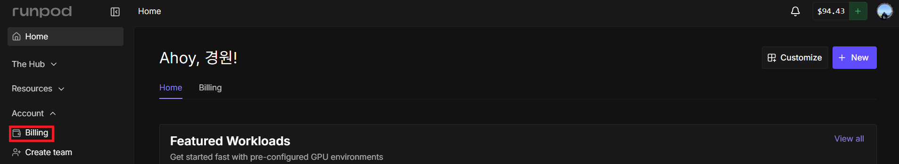
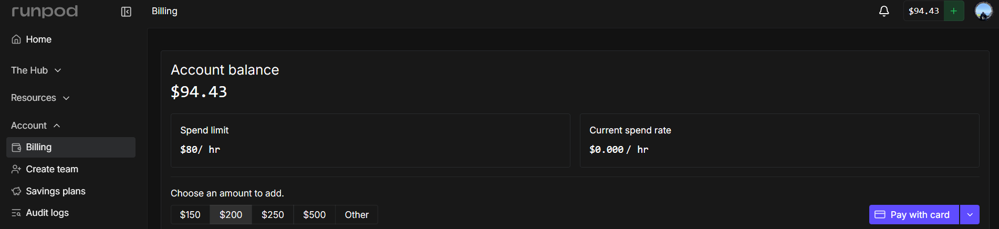

# [클라우드 GPU란?](https://www.samsungsds.com/kr/gpu-server/gpu-server.html)
- 한마디로 말하면, **"필요할 때 빌려 쓰는 고성능 컴퓨터"** 입니다.
- 원래 AI 연구나 대용량 연산을 하려면 GPU(고성능 그래픽 처리 칩)가 달린 비싼 서버를 직접 사야 했어요. 클라우드 GPU 서버는 그걸 **인터넷으로 빌려서** 쓰는 방식입니다.
 
> CPU, GPU, 메모리 같은 자원을 개별 구매할 필요 없이, 필요한 시점에 필요한 만큼 자유롭게 할당받아 사용하는 가상화 컴퓨팅 서비스입니다.

---
## 쉽게 비유하면?
- 택시 vs 자가용
- `자가용(= 서버 직접 구매)`은 항상 유지비가 들지만, `택시(= 클라우드 GPU)`는 탈 때만 돈을 냅니다. 
- 필요할 때 크게, 필요 없을 때 줄일 수 있어서 훨씬 경제적입니다.

---
## 주요 특징 4가지
| 특징 | 설명 |
|------|------|
| **쉬운 설정** | 웹 콘솔에서 클릭 몇 번으로 서버 생성·모니터링·비용 관리까지 가능 |
| **다양한 사양** | GPU 카드(A100, H100) 수량을 필요에 따라 자유롭게 선택 |
| **강력한 보안** | 외부 트래픽을 제어해 서버를 안전하게 보호 |
| **편리한 네트워크** | IP 설정 변경, 인터넷 연결(NAT) 필요할 때만 켜고 끄기 가능 |


---
## 내 컴퓨터로 AI를 돌리면 어떤 일이 생길까?

AI 모델을 학습시키거나 실행하려면 **엄청난 연산 능력**이 필요합니다.  
일반 노트북이나 PC로 돌리면 이런 문제가 생겨요:

- **너무 느리다** — 몇 시간짜리 작업이 며칠이 걸림
- **컴퓨터가 과열된다**
- **아예 실행이 안 된다** — GPU(그래픽카드)가 없으면 불가

---
## 그래서 클라우드 GPU를 씁니다

> **클라우드 GPU = 인터넷으로 빌려 쓰는 고성능 컴퓨터**

마치 렌터카처럼, 필요할 때만 빌리고 다 쓰면 반납(종료)하면 됩니다.

| 구분 | 내 PC | 클라우드 GPU |
|------|-------|-------------|
| 초기 비용 | GPU 구매 (100만원~) | 없음 |
| 사용 비용 | 전기세 | 시간당 요금 |
| 성능 | 제한적 | 최신 고성능 GPU |
| 언제든 사용 | ✅ | ✅ |

---
# [RunPod는 무엇이고 왜 쓰나요?](https://www.runpod.io/)
> RunPod는 클라우드 GPU 서비스입니다.

---
## 클라우드 GPU 서비스는 여러 개가 있어요

| 서비스 | 특징 |
|--------|------|
| **AWS / GCP** | 대기업 서비스, 기능 많지만 복잡하고 비쌈 |
| **Google Colab** | 무료지만 시간 제한 있고 느림 |
| **RunPod** | 저렴하고 간단, AI에 특화 |

---
## RunPod의 장점

- **저렴하다** — 시간당 $0.2~0.8 수준 (AWS 대비 훨씬 저렴)
- **빠르게 시작** — 1~2분이면 GPU 서버 켜짐
- **AI에 특화** — Stable Diffusion, LLM 등 AI 템플릿 기본 제공
- **웹에서 바로 접속** — 복잡한 설정 없이 브라우저로 사용 가능

---
## RunPod의 요금 개념 이해

---
### 기본 원칙: 켜놓은 시간만큼 돈이 나간다

```
요금 = 시간당 가격 × 사용한 시간
```

예시: 시간당 $0.5짜리 GPU를 3시간 쓰면 → **$1.5 청구**

---
### 요금 절약 핵심 팁

> **가장 중요: 안 쓸 때는 반드시 끄세요!**

| 상황 | 해야 할 일 |
|------|-----------|
| 잠깐 자리 비울 때 | Pod **중지(Stop)** — 스토리지 요금만 과금 |
| 완전히 끝났을 때 | Pod **삭제(Terminate)** — 요금 0원 |
| 실수로 켜놓으면 | 자는 동안에도 요금 계속 나감|

---

### RunPod의 GPU 종류별 요금 예시

| GPU | 시간당 요금 | 적합한 용도 |
|-----|-----------|------------|
| RTX 3090 | ~$0.3 | 가벼운 실습, 입문 |
| RTX 4090 | ~$0.5 | 이미지 생성, 중형 LLM |
| A100 80GB | ~$1.5 | 대형 모델 학습 |

> 처음엔 **RTX 3090 또는 4090**으로 시작하는 걸 추천합니다!

---
### 크레딧 충전 방식
[1. RunPod에 로그인](https://www.runpod.io/)



---
2. 상단 메뉴 → **Billing**



---
3. 신용카드로 원하는 만큼 충전 (최소 $10)


