# [Pods](https://console.runpod.io/deploy?type=GPU)
- Pod는 쉽게 말해 클라우드에서 빌려 쓰는 GPU 컴퓨터입니다.
- 내 컴퓨터에 GPU가 없어도, RunPod에서 Pod를 만들면 강력한 GPU가 달린 서버를 바로 사용할 수 있습니다.

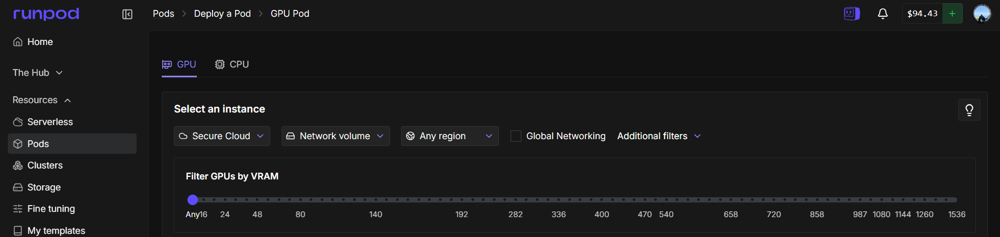

---
## GPU Pod 설정 옵션 가이드

| 상황 | 추천 설정 |
|------|-----------|
| 일반 AI 학습 | Secure Cloud + Any Region |
| 비용 절감 | Community Cloud |
| 데이터 재사용 | Network Volume 연결 |
| 멀티 노드 학습 | Global Networking 활성화 |
| 대형 모델 실행 | VRAM 슬라이더 80GB 이상 |

---
### Secure Cloud
 
- **무엇인가?** GPU 서버가 위치한 **클라우드 환경**을 선택하는 옵션
- **Secure Cloud** → 보안이 강화된 데이터센터 (기본값)
- **Community Cloud** → 개인이 제공하는 서버 (더 저렴하지만 보안 낮음)
 
> 중요한 작업이라면 Secure Cloud, 비용 절감이 목적이라면 Community Cloud 선택

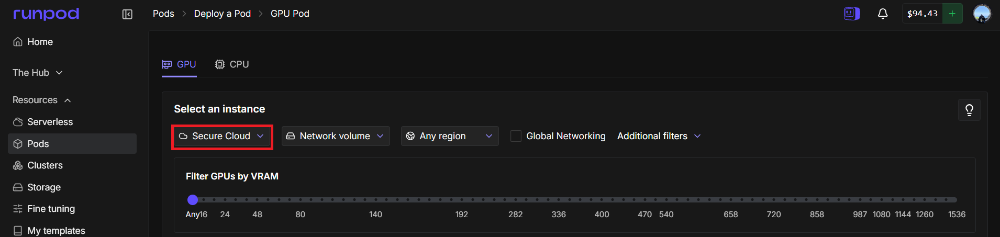

---
### Network Volume
 
- **무엇인가?** Pod에 연결할 **외부 저장소(디스크)**를 선택하는 옵션
- Pod를 종료해도 데이터가 **사라지지 않고 유지**됨
- 여러 Pod 간에 **같은 데이터를 공유** 가능
 
> 모델 파일, 데이터셋처럼 용량 큰 파일을 반복 사용할 때 유용

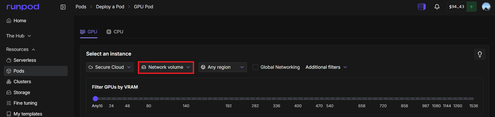

---
### Any Region
 
- **무엇인가?** GPU 서버가 있는 **지역(국가/대륙)**을 선택하는 옵션
- `Any Region` → 전 세계 어디든 가용한 서버 사용 (기본값)
- 특정 지역 선택 시 → 해당 지역 서버만 필터링
 
> 속도가 중요하다면 **가까운 지역** 선택, 가용성이 중요하다면 Any Region 유지

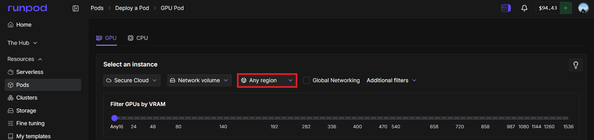

---
### Global Networking
 
- **무엇인가?** Pod 간 **내부 네트워크 통신**을 가능하게 하는 옵션
- 체크 시 → 여러 Pod끼리 **빠른 내부망**으로 연결 가능
- 분산 학습(Multi-GPU/Multi-Node) 시 유용
 
> 단일 GPU 작업이면 **체크 불필요**, 멀티 노드 학습이면 **체크 권장**

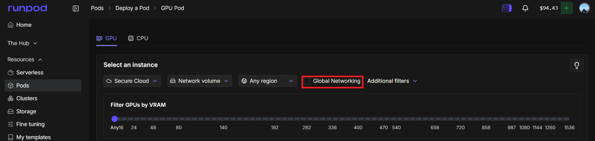

---
### VRAM 필터 슬라이더
 
- **무엇인가?** 원하는 **최소 VRAM 용량**으로 GPU를 필터링
- 슬라이더를 오른쪽으로 이동할수록 고용량 GPU만 표시
- 범위: 16GB ~ 1536GB
 
> 실행할 모델 크기에 맞는 VRAM 선택 (예: LLaMA 70B → 최소 80GB 권장)

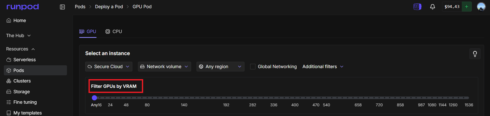

---
## GPU Pod 정보 

---
### 하드웨어 사양(성능)
- `RTX 5090`: 그래픽 카드(GPU)
- `32GB VRAM`: GPU RAM
- `60GB RAM`: CPU RAM
- `16 vCPU`: 가상 CPU 코어 수

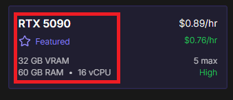

---
### 가격 및 상태 
- `$0.89/hr`: On-demand 가격
- `$0.76/hr`: Interruptible 가격
- `5 max`: 한 번에 최대 5대까지 빌리 수 있음
- `High`: 가용성(Availability) 상태 

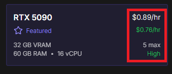

---
#### 가용성(Availability) 상태
- `High (높음)`: 현재 해당 GPU 모델을 갖춘 서버가 아주 많이 남아 있다는 뜻입니다. 클릭하는 즉시 바로 서버를 빌려(Deploy) 작업을 시작할 수 있습니다.
- `Medium (중간)`: 재고가 어느 정도 있지만, 사용자가 몰리면 금방 매진될 수 있는 상태입니다.
- `Low (낮음)`: 재고가 거의 없습니다. 운 좋게 한두 대를 빌릴 수도 있지만, 대부분의 경우 "현재 사용 가능한 서버가 없습니다"라는 메시지를 보게 될 확률이 높습니다.

---
#### 'Availability'가 왜 중요한가?
단순히 "빌릴 수 있다/없다"를 넘어, 여러분의 비용과 작업 안정성에 직접적인 영향을 미칩니다.

- `On-Demand (정가제)` 사용자:
  - 가용성이 **'High'**일 때 빌리면 작업 도중 서버가 끊길 걱정 없이 안정적으로 사용할 수 있습니다.
  - 하지만 재고가 아예 없으면 아무리 돈을 많이 내려고 해도 서버를 열 수 없습니다.
- `Interruptible (경매/할인제)` 사용자:
  - 이 방식은 남는 서버를 저렴하게 빌려 쓰는 구조입니다.
  - 가용성이 **'Low'**로 떨어지면, RunPod 시스템은 저렴하게 쓰고 있는 여러분의 서버를 강제로 회수해서 `정가를 내는(On-Demand) 사람`에게 넘겨줍니다. 즉, 내 작업이 예고 없이 중단될 위험이 커집니다.

---
## GPU Pod 실행 

---
### 단계1: Pod 선택 
> RunPod의 GPU 종류별 요금 확인

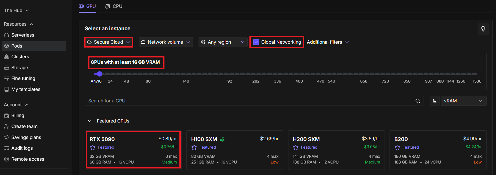

---
### 단계2: Pod 실행 

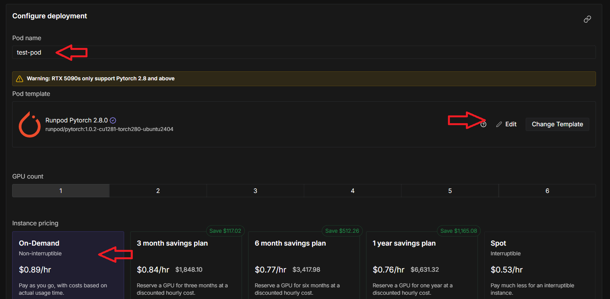

---
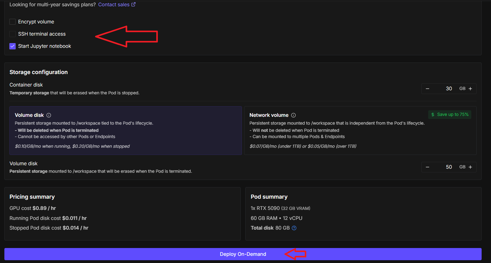

---
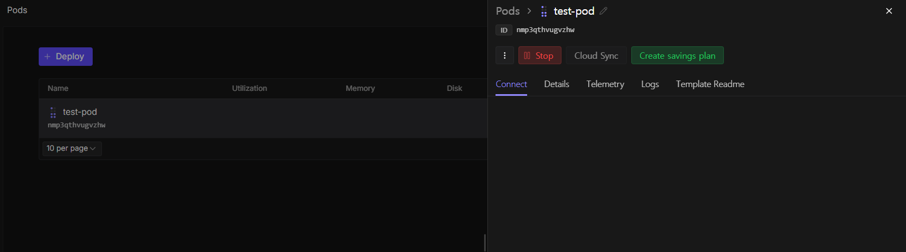

---
### 단계3: Pod 접속 및 사용
> 요금 = 시간당 가격 × 사용한 시간

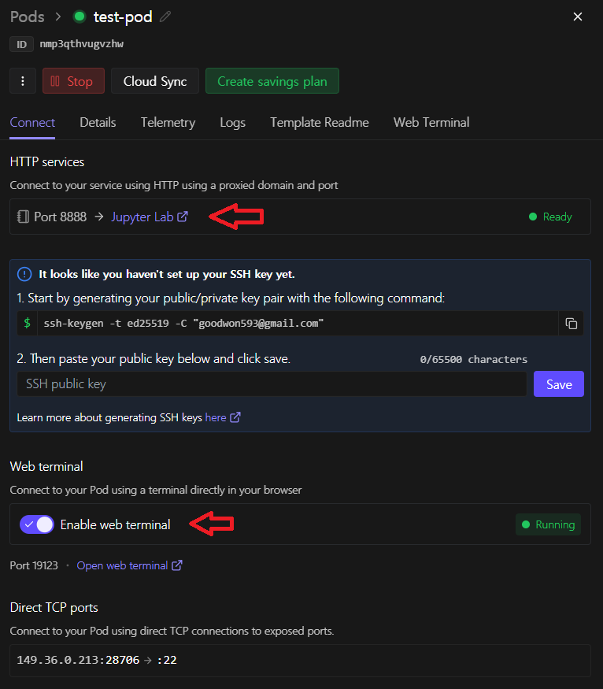

---
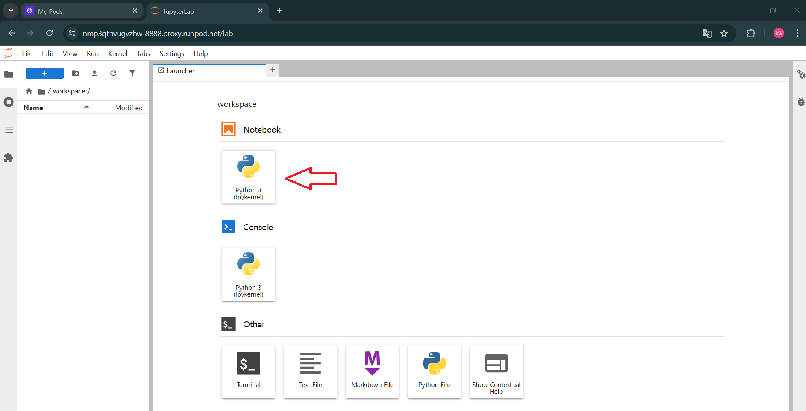

---
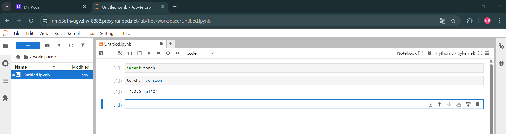

---
### 단계4: Pod 멈추기 
> Pod **중지(Stop)** — 스토리지 요금만 과금

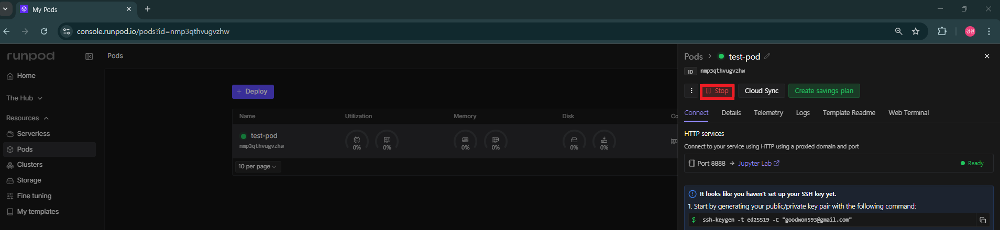

---
### 단계5: Pod 삭제하기 
> Pod **삭제(Terminate)** — 요금 0원

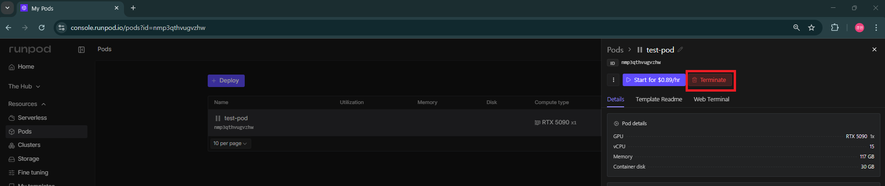

---
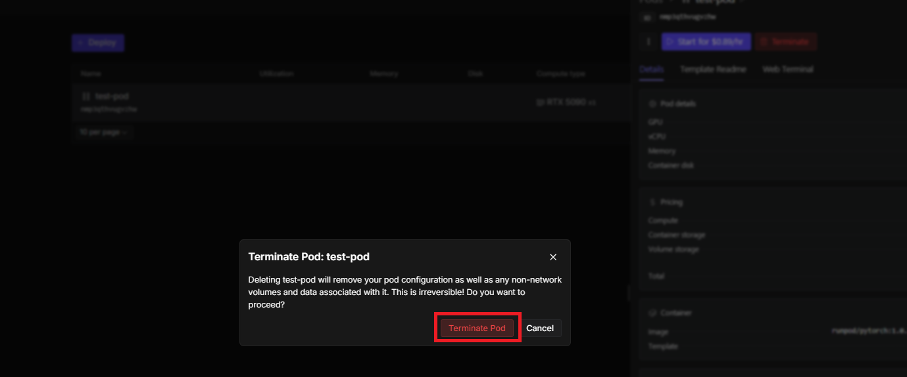
