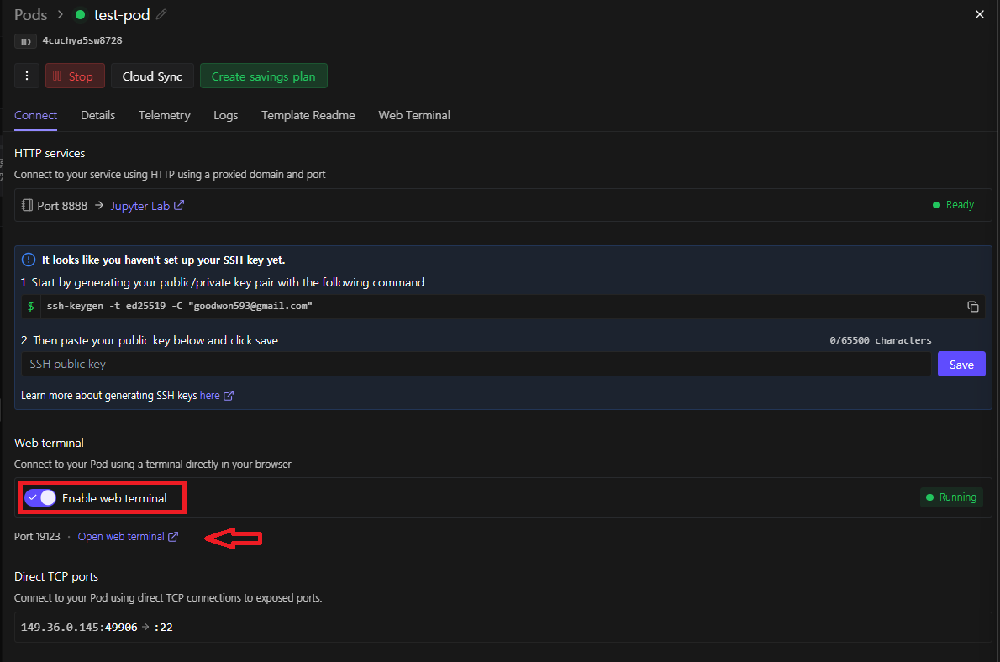
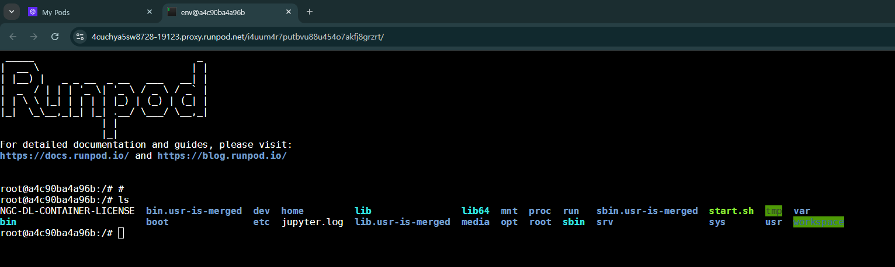
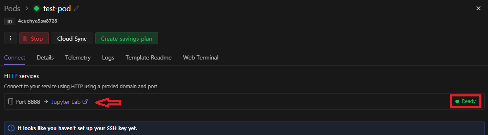
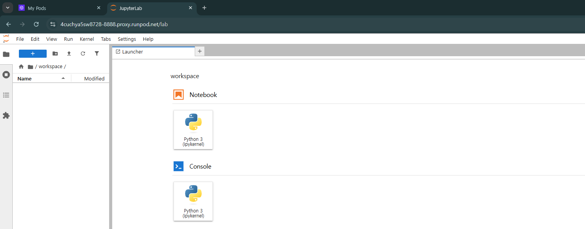

# [Connect to Pods](https://docs.runpod.io/pods/connect-to-a-pod)

---
## 연결 방법 종류

| 방법 | 언제 쓰나요? | 연결 유지 | 준비물 |
|------|-------------|----------|--------|
| **웹 터미널** | 빠른 명령어 실행, 디버깅 | 세션 동안만 | 없음 |
| **SSH** | 장시간 작업, 안정적인 접속 | 영구적 | SSH 클라이언트 |
| **JupyterLab** | 데이터 분석, 노트북 작업 | 세션 동안만 | 지원 템플릿 필요 |
| **VS Code / Cursor** | 풀 개발 환경 | 영구적 | 확장 프로그램 |

---
## 방법1: 웹 터미널 (Web Terminal)
- 브라우저에서 바로 터미널을 사용하는 방법이
- 장시간 작업에는 적합하지 않아요. 그럴 땐 SSH

---
### 접속 방법

1. [Pods 페이지](https://console.runpod.io/pods)에 접속
2. 사용할 Pod를 클릭하고 **Connect** 버튼 클릭
3. **Start** 버튼 클릭 후 → **Open Web Terminal** 클릭

---
> **Start 버튼이 반응 없을 때** → 페이지를 새로고침

---
## 방법2: JupyterLab
- 코드, 파일, 데이터 분석을 웹에서 할 수 있는 환경
- RunPod 공식 PyTorch 템플릿에는 기본으로 설치되어 있음

---
### 접속 방법

1. JupyterLab이 포함된 템플릿으로 Pod 생성 (예: `Runpod Pytorch`)
2. [Pods 페이지](https://console.runpod.io/pods)에서 **Connect** 클릭
3. **HTTP Services** 항목에서 **Jupyter Lab** 링크 클릭 (보통 포트 8888)

---

