# SSH 연결
- 안전하고 안정적인 방법으로, 장시간 작업에 가장 추천

---
## SSH 키 생성 및 등록

---
### 단계1: SSH 키 생성
> 명령어 실행 후 Enter 3번 실행!
```bash
ssh-keygen -t ed25519 -C "YOUR_EMAIL@DOMAIN.COM"
```
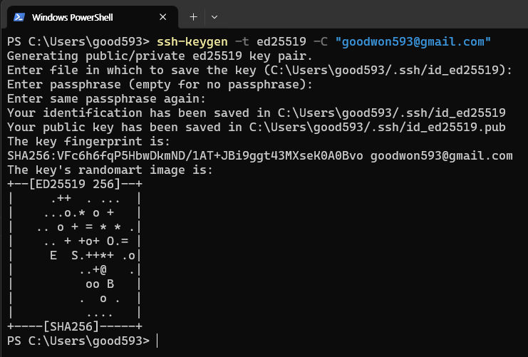

---
- 생성된 키 위치:
  - 공개키: **Runpod 등에 등록**
    - `~/.ssh/id_ed25519.pub`
  - 개인키: **타인에게 공개 금지**
    - `~/.ssh/id_ed25519`

- Windows(CMD) 사용 시: 
  - `C:\Users\사용자명\.ssh\` 

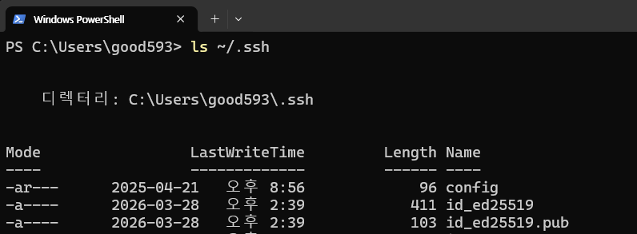

---
#### 주의사항 (권한 설정)
- WSL 2나 리눅스 환경에서 config 파일이나 키 파일의 권한이 너무 개방되어 있으면 SSH 접속이 거부될 수 있습니다. 
- 이 경우 아래 명령어로 권한을 조정해 주세요.
  ```shell
  chmod 600 ~/.ssh/config
  chmod 600 ~/.ssh/id_ed25519
  ```

---
### 단계2: 공개키 확인
```bash
cat ~/.ssh/id_ed25519.pub
```

출력 예시:
```
ssh-ed25519 AAAAC4NzaC1lZDI1JTE5AAAAIGP+L8h... YOUR_EMAIL@DOMAIN.COM
```

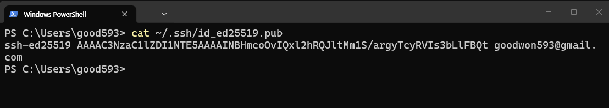

---
### 단계3: [RunPod 공개키 등록](https://console.runpod.io/user/settings)
> 여러 키를 등록할 경우, 각 키를 **새 줄**로 구분

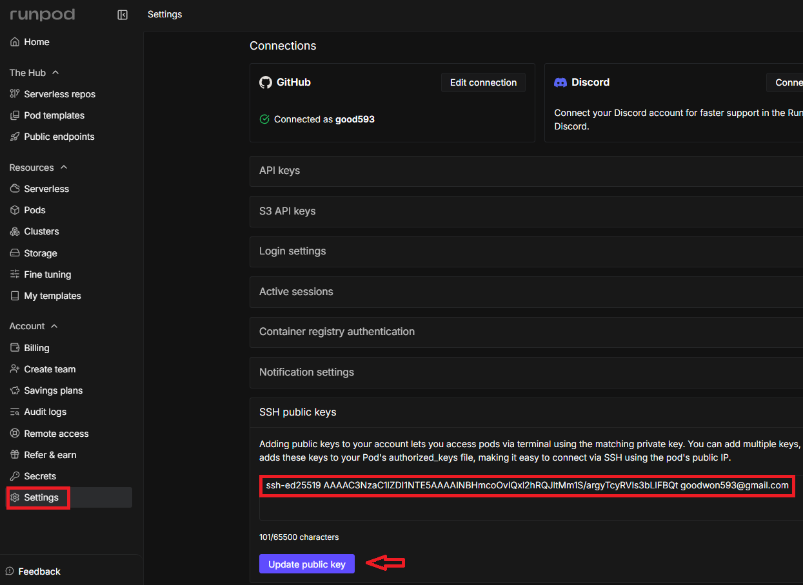

---
# SSH 연결 방법 3가지

| 방법 | 파일 전송 지원 | 추천 상황 |
|------|--------------|----------|
| **기본 SSH** | ❌ | 빠른 접속, 일반 Pod |
| **공개 IP SSH** | ✅ | 파일 전송, 풀 SSH 기능 |

---
## 1. 기본 SSH 연결

---
### 단계1: [Pods 페이지](https://console.runpod.io/pods)에서 Pod 선택

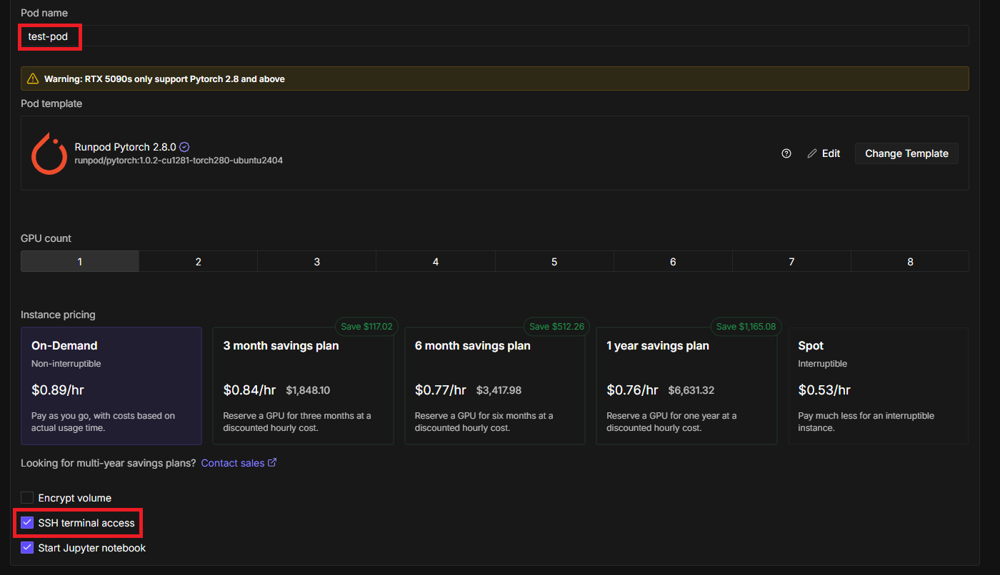

---
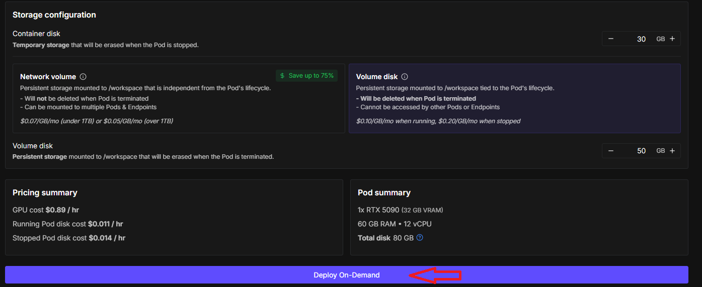

---
### 단계2: **SSH** 항목의 명령어 복사

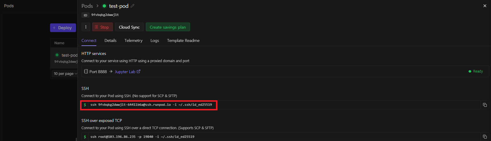

---
### 단계3: 터미널에 붙여넣고 실행 > yes

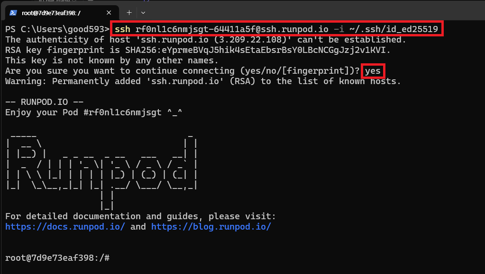

---
### 단계4: 접속 확인 및 나가기(exit) 

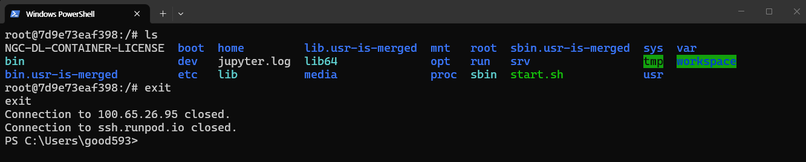

---
## 2. 공개 IP SSH 연결 (파일 전송 가능)
-  SCP, SFTP 등 파일 전송이 필요할 때 사용  
- 공식 RunPod 템플릿(PyTorch, Stable Diffusion)은 자동 설정됨

---
> 커스텀 템플릿 사용 시 아래 명령어를 Docker 시작 명령에 추가:
```bash
bash -c 'apt update; \
DEBIAN_FRONTEND=noninteractive apt-get install openssh-server -y; \
mkdir -p ~/.ssh; \
cd ~/.ssh; \
chmod 700 ~/.ssh; \
echo "$PUBLIC_KEY" >> authorized_keys; \
chmod 700 authorized_keys; \
service ssh start; \
sleep infinity'
```

---
### 단계1: **SSH over exposed TCP** 항목의 명령어 복사

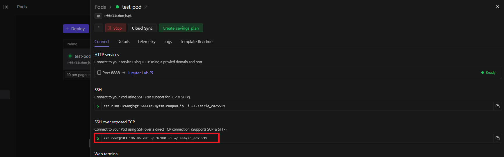

---
### 단계2: 터미널에 붙여넣고 실행

```bash
명령어 예시:
ssh root@213.173.108.12 -p 17445 -i ~/.ssh/id_ed25519
```
```bash
명령어 구조:
ssh root@[Pod IP 주소] -p [SSH 포트] -i [개인키 경로]
```
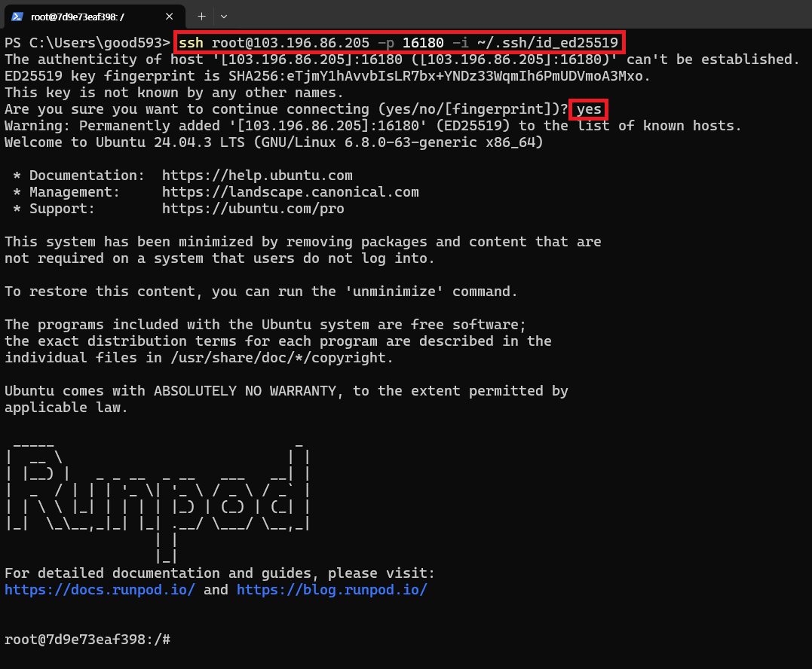

---
## 3. [VS Code / Cursor 연결](https://docs.runpod.io/pods/configuration/connect-to-ide)
- 로컬 VS Code나 Cursor에서 Pod를 원격으로 개발할 수 있음.  

---
### 단계1: Install the Remote-SSH extension
> Cursor: Remote-SSH by Anysphere.

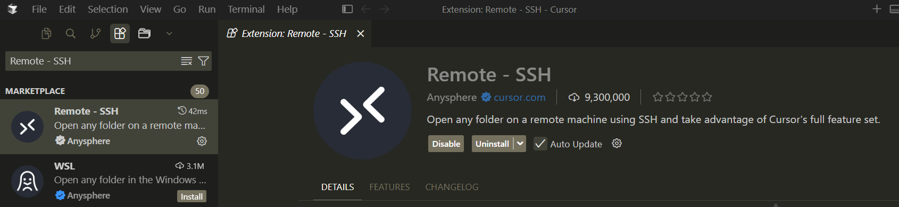

---
> VSCode: Remote - SSH by ms-vscode-remote.

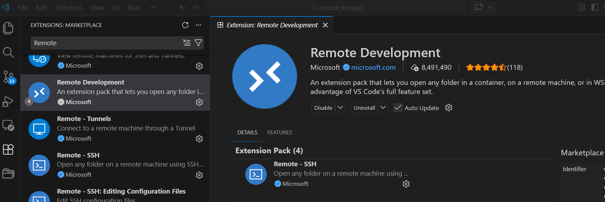

---
### 단계2: Host 등록 
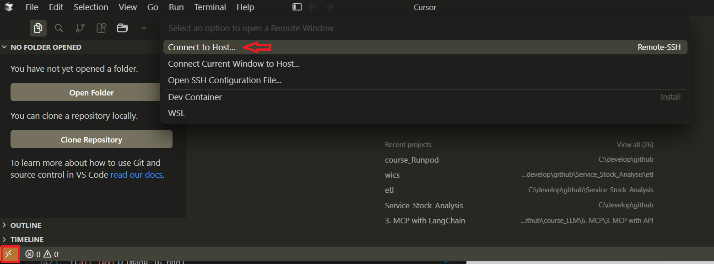

---
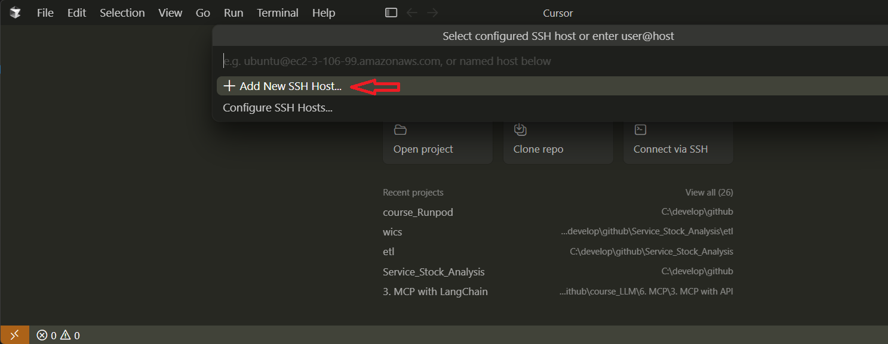

---
- SSH over exposed TCP 항목의 명령어 복사
```shell
# ssh root@[Pod IP 주소] -p [SSH 포트] -i [개인키 경로]
ssh root@103.196.86.205 -p 16180 -i ~/.ssh/id_ed25519
```


---
- SSH over exposed TCP 정보를 이용해서 Host 작성 
```shell
Host my-server # 접속할 때 사용할 별명
    # Pod IP 주소
    HostName 103.196.86.205 
    # 접속할 계정명(root)
    User root
    # SSH 포트
    Port 16180
    # 개인키 경로
    IdentityFile ~/.ssh/id_ed25519
```
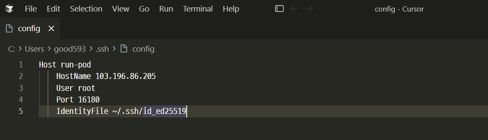

---
### 단계3: Runpod 접속  


---
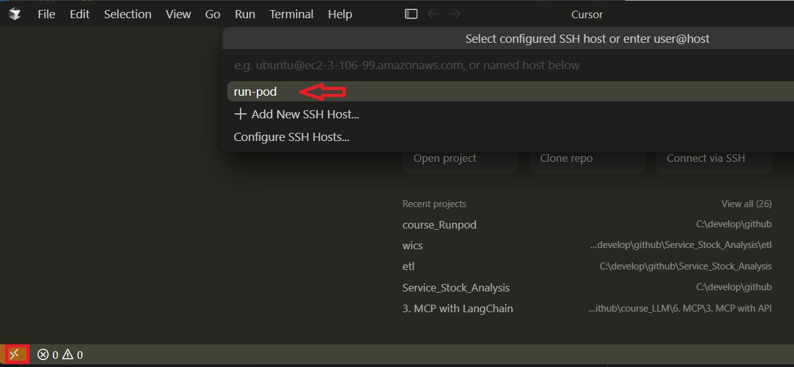

---
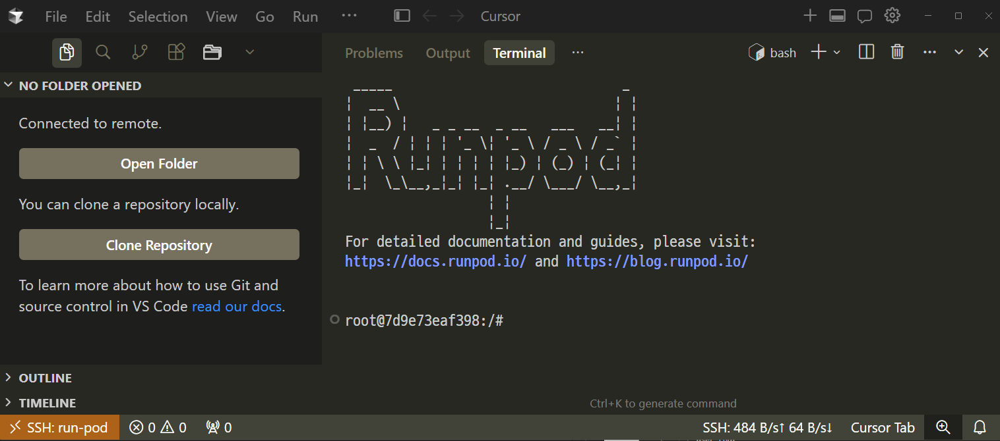
