# [Storage](https://docs.runpod.io/pods/storage/types)
> Storage 종류 3가지

| 종류 | Pod 꺼도 유지? | Pod 삭제해도 유지? | 공유 가능? |
|---|---|---|---|
| Container Disk | ❌ | ❌ | ❌ |
| Volume Disk | ✅ | ❌ | ❌ |
| Network Volume | ✅ | ✅ | ✅ |

---
## 요금
- `Container Disk (컨테이너 디스크)`는 Pod가 멈춰있을 때 두 배 요금이 부과될 수 있으니 주의하시기 바랍니다.
- `Volume Disk (볼륨 디스크)`는 Pod를 **중지(stop)만 해도 계속 청구됩니다.**
- `Network Volume (네트워크 볼륨)`은 **GB당 월 $0.05** (100GB = 월 $5)

---
## 1. Container Disk (컨테이너 디스크)
- **임시 저장소**입니다.
- Pod가 꺼지면 데이터가 **전부 사라집니다**.
- 운영체제 파일이나 캐시처럼 잠깐만 필요한 파일에 사용합니다.

---
### 단계1: Container Disk 수정 
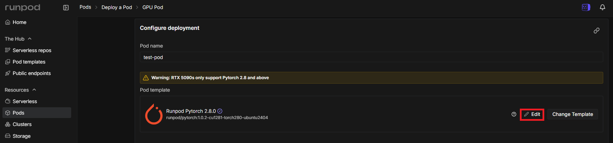

---
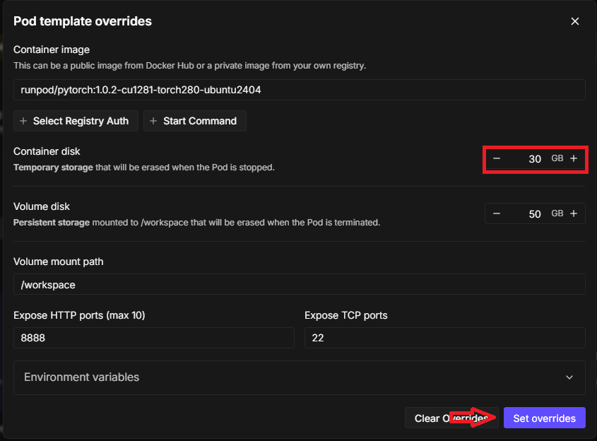

---
### 단계2: Pod 실행 
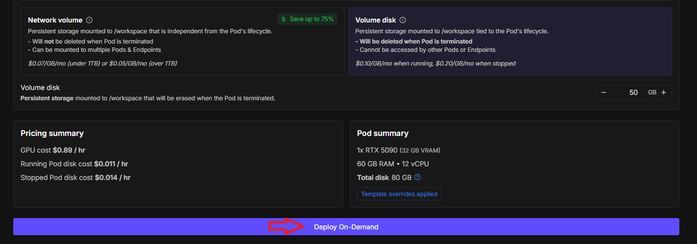

---
> Pod 접속
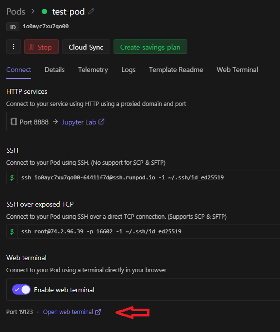

---
### 단계3: 폴더(test) 및 파일(sample.txt) 생성
```shell
# 폴더 생성
mkdir /test
# 파일 생성
touch /test/sample.txt
# 확인 
ls /test
```
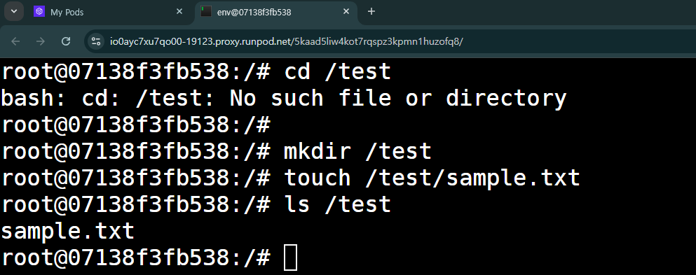

---
### 단계4: Pod 재시작
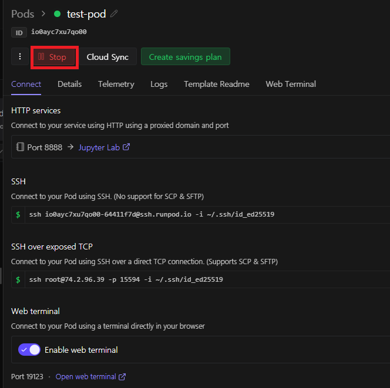

---
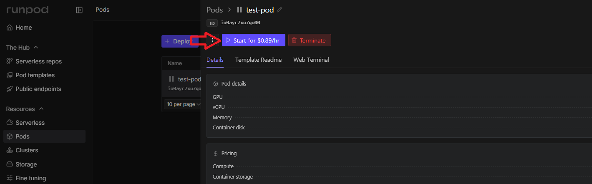

---
### 단계5: Pod 재접속 
- 폴더/파일 확인 


---
> 데이터(폴더/파일)가 **전부 사라짐**.
```shell
# 확인 
ls /test
```
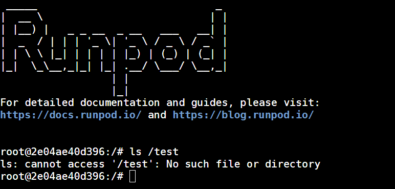

---
## 2. Volume Disk (볼륨 디스크)
- **반영구적 저장소**입니다.
- Pod를 껐다가 다시 켜도 `/workspace` 폴더의 데이터는 유지됩니다.
- 단, Pod 자체를 **삭제(terminate)하면 사라집니다**.
- 모델, 데이터셋, 체크포인트 저장에 적합합니다.

---
### 단계1: Volume Disk 수정 


---
- Volume mount path
  - Volume Disk가 저장되는 위치
  - `/workspace`
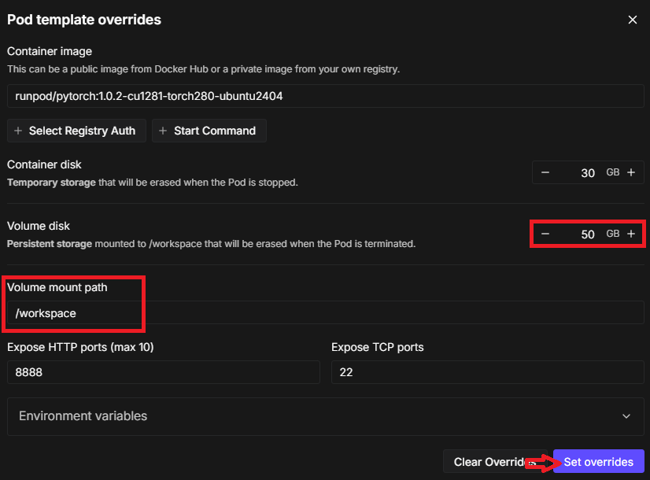

---
### 단계2: Volume Disk 선택 후 Pod 실행 
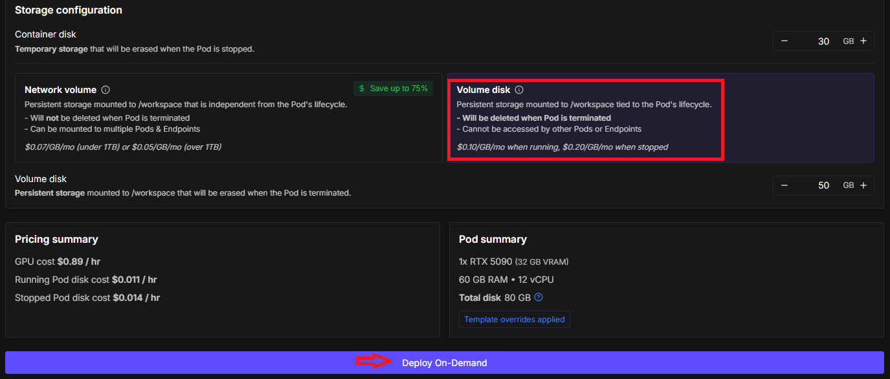

---
> Pod 접속


---
### 단계3: 폴더(test) 및 파일(sample.txt) 생성
- Volume mount path: `/workspace`

```shell
# 폴더 생성
mkdir /workspace/test
# 파일 생성
touch /workspace/test/sample.txt
# 확인 
ls /workspace/test
```
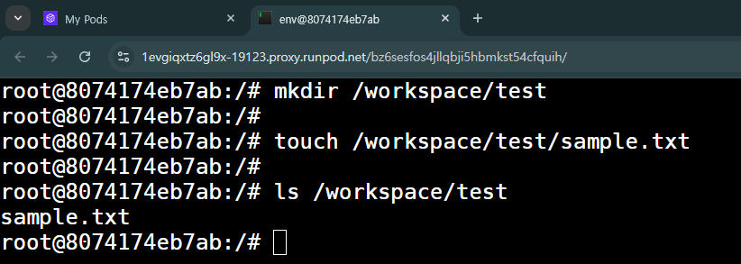

---
### 단계4: Pod 재시작


---


---
### 단계5: Pod 재접속 
- 폴더/파일 확인 


---
> 데이터(폴더/파일)가 **전부 존재함**.
```shell
# 확인 
ls /workspace/test
```
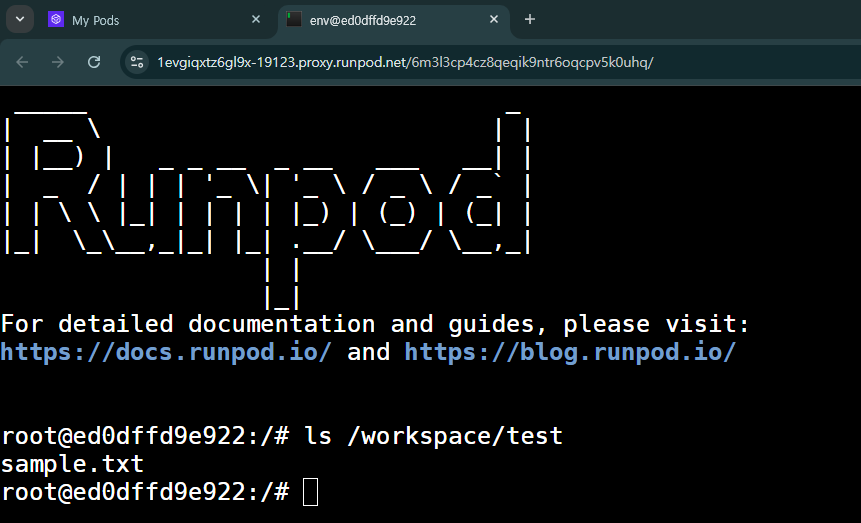


