# [Storage](https://docs.runpod.io/pods/storage/types)
> Storage 종류 3가지

| 종류 | Pod 꺼도 유지? | Pod 삭제해도 유지? | 공유 가능? |
|---|---|---|---|
| Container Disk | ❌ | ❌ | ❌ |
| Volume Disk | ✅ | ❌ | ❌ |
| Network Volume | ✅ | ✅ | ✅ |

---
## 요금
- `Container Disk (컨테이너 디스크)`는 Pod가 멈춰있을 때 두 배 요금이 부과될 수 있으니 주의하시기 바랍니다.
- `Volume Disk (볼륨 디스크)`는 Pod를 **중지(stop)만 해도 계속 청구됩니다.**
- `Network Volume (네트워크 볼륨)`은 **GB당 월 $0.05** (100GB = 월 $5)

---
## Network Volume (네트워크 볼륨)
- **영구적 저장소**입니다.
- Pod를 삭제해도 데이터가 **유지됩니다**.
- 여러 개의 Pod에 동시에 연결하여 공유할 수 있습니다.
- Pod 생성 시에만 연결할 수 있으며, 이후에는 분리할 수 없습니다.
- `/workspace` 위치에 마운트됩니다.

---
### 단계1: [Network Volume 설정](https://console.runpod.io/user/storage)
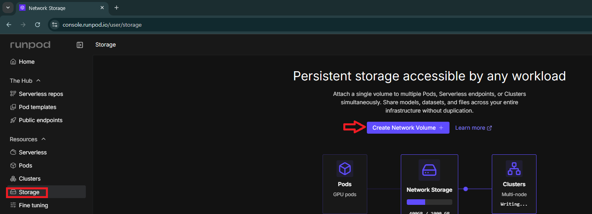

---
#### Networking Options
- `Global Networking`: RunPod의 자체 글로벌 네트워크망을 사용하는 방식입니다. 데이터 센터 간 또는 인터넷을 통한 데이터 전송에 최적화된 표준 옵션입니다.
- `S3 compatible`: 아마존의 S3와 호환되는 API를 통해 스토리지에 접근할 수 있음을 의미합니다. 외부 툴이나 SDK를 이용해 데이터를 관리할 때 유리합니다.

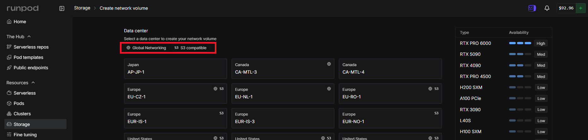

---
#### Data center
- 네트워크 볼륨이 실제로 생성되어 데이터가 저장될 **물리적 위치(리전)**를 선택하는 곳입니다.
- `주의사항`: 화면 상단의 안내 문구처럼 네트워크 볼륨은 선택한 특정 리전에 종속됩니다. 즉, 일본 리전에 볼륨을 만들면 나중에 일본 데이터 센터에 있는 GPU 서버(Pod)에서만 이 데이터를 연결해 사용할 수 있습니다

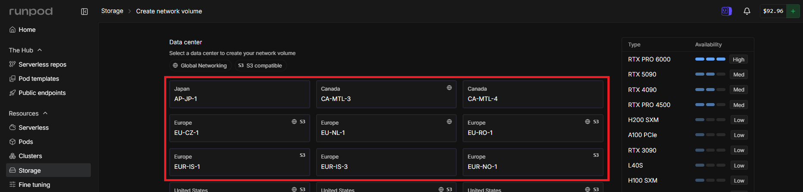

---
#### GPU Type & Availability
- 현재 선택된 데이터 센터 리전에서 어떤 GPU를 즉시 사용할 수 있는지 보여주는 실시간 현황판입니다.
- `Type`: RTX PRO 4500, H200 SXM, RTX 4090 등 해당 리전이 보유한 GPU 모델명입니다.
- `Availability`:
  - `Med (Medium)`: 어느 정도 여유가 있어 즉시 할당받을 가능성이 높습니다.
  - `Low`: 현재 사용 중인 사용자가 많아 Pod을 생성하기 어려울 수 있습니다.

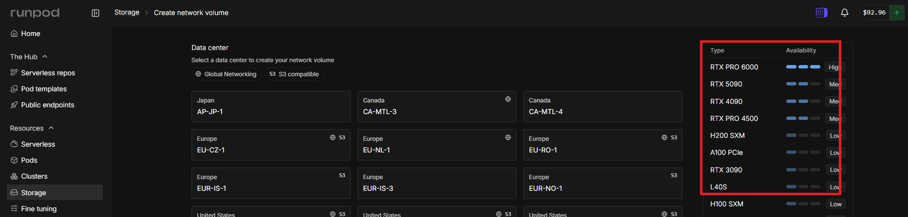

---
### 단계2: Network Volume 생성하기 
> 물리적 위치(리전) & Type 확인 

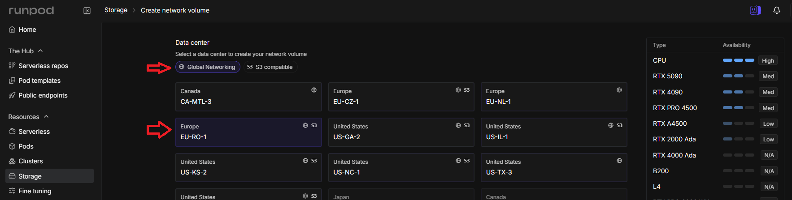

---
> Name & Size 설정 

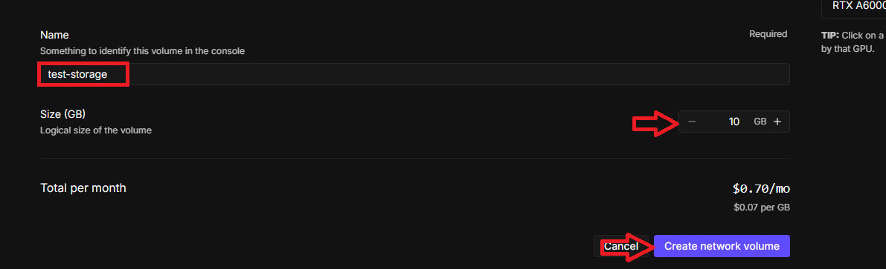

---
> 결과 확인 

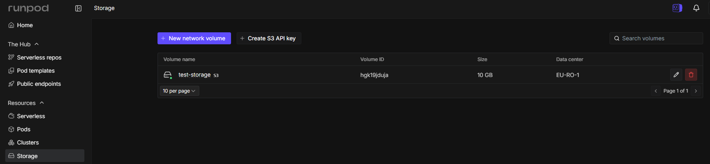

---
### 단계3: GPU Pod 생성하기  
> 생성한 Network Volume 연결 

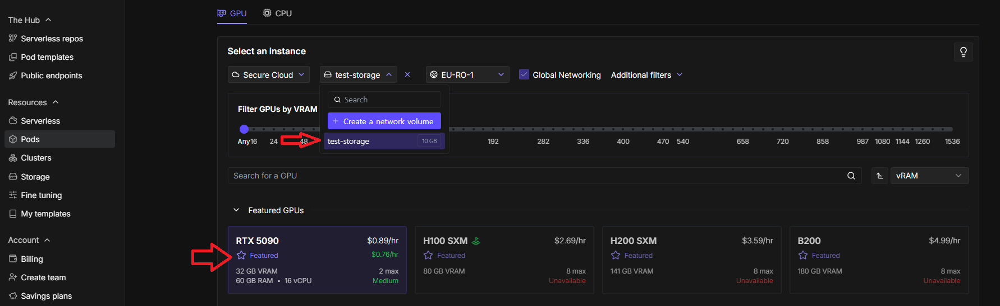

---
> Network Volume 확인 및 생성 

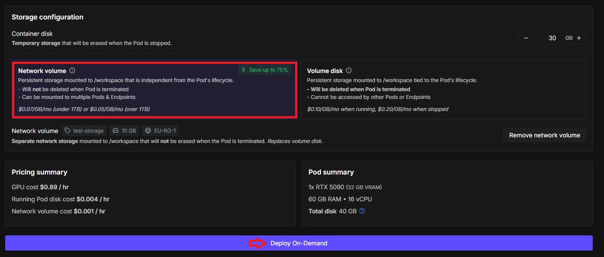

---
### 단계4: GPU Pod 접속하기 
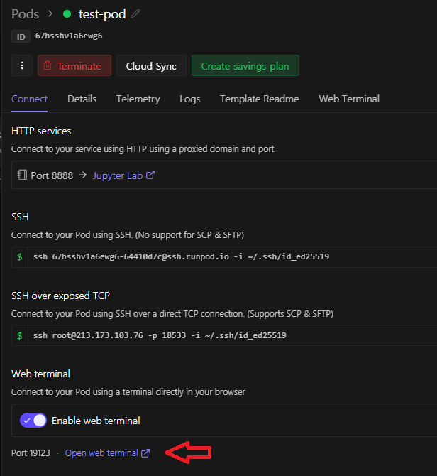

---
### 단계5: 폴더(test) 및 파일(sample.txt) 생성
- Network Volume path: `/workspace`

```shell
# 폴더 생성
mkdir /workspace/test
# 파일 생성
touch /workspace/test/sample.txt
# 확인 
ls /workspace/test
```

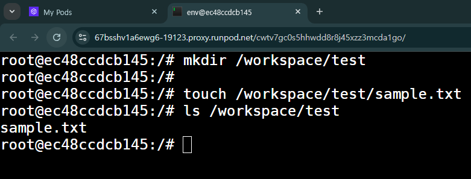

---
### 단계6: GPU Pod 삭제 
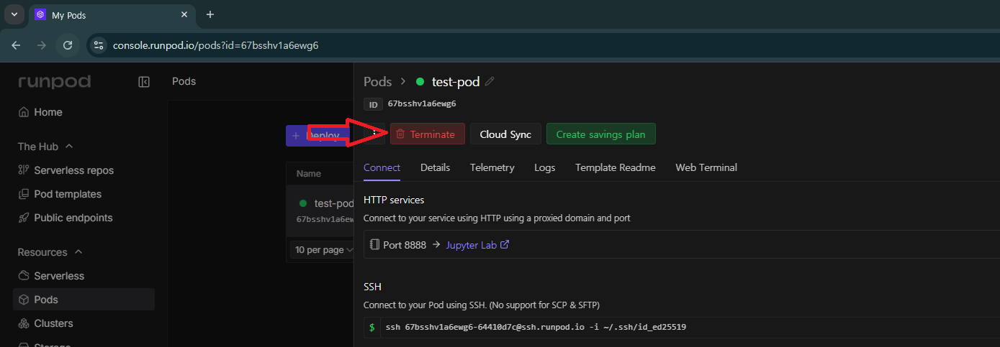

---
### 단계7: GPU Pod 다시 생성 및 확인 
> 생성한 Network Volume 연결 

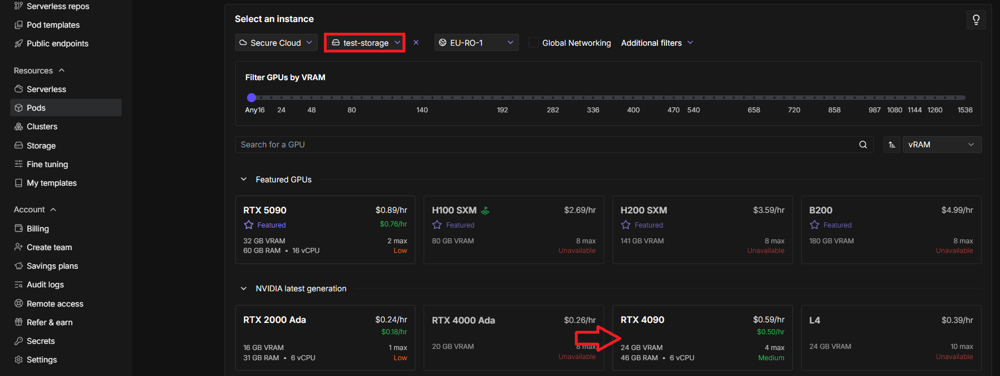

---
- 데이터 확인 
- Network Volume path: `/workspace`

```shell
# 확인 
ls /workspace/test
```
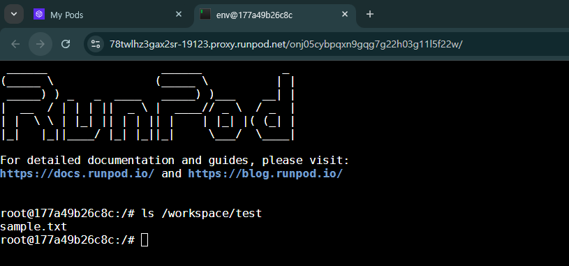

