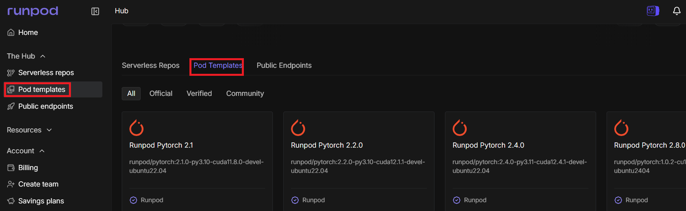
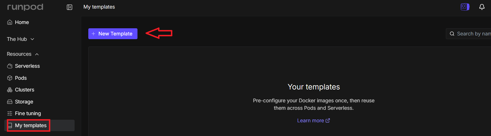
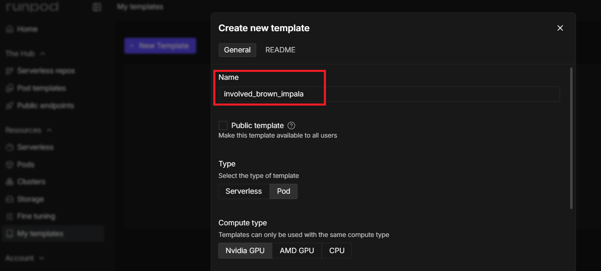
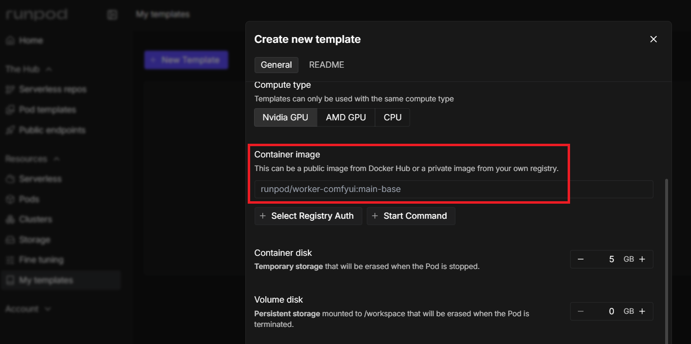
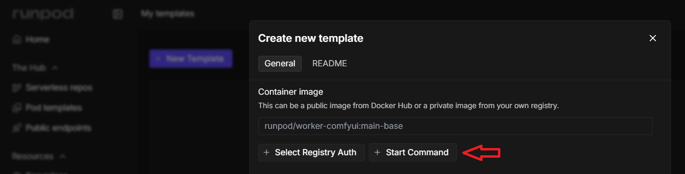
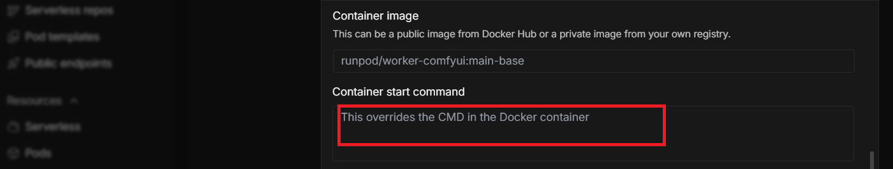
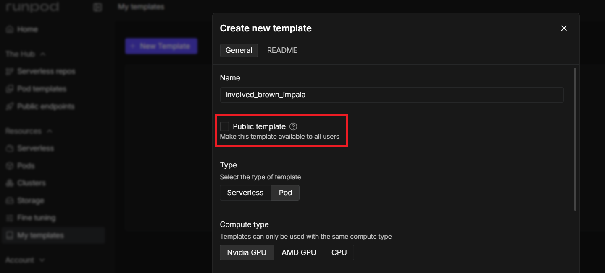
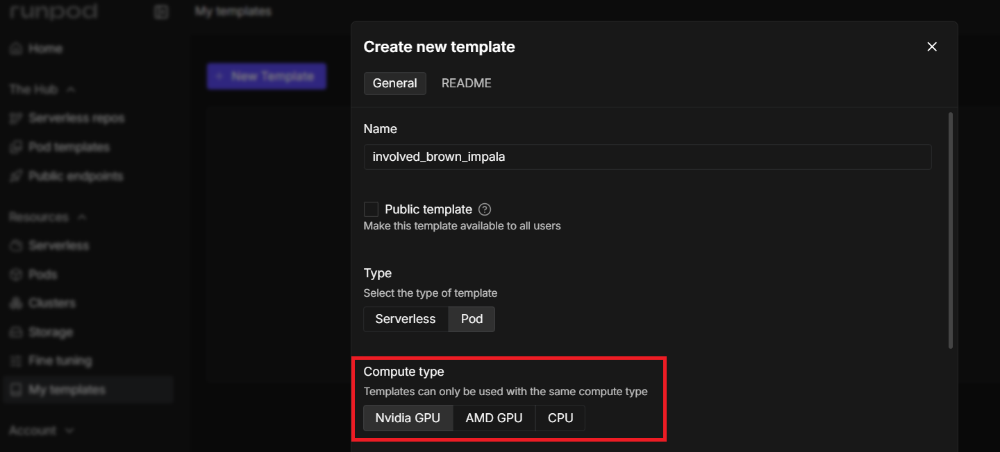
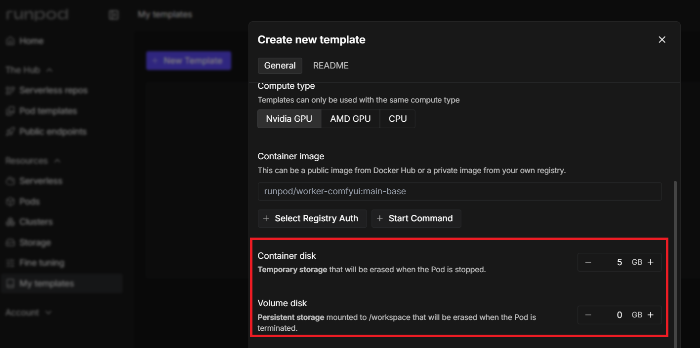
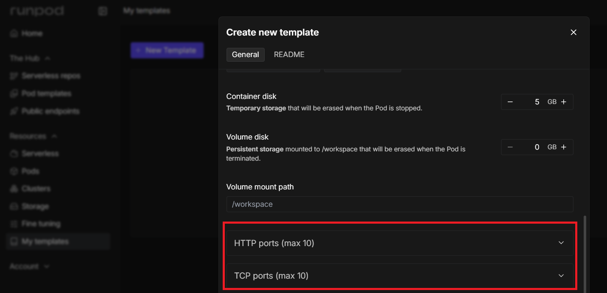

# [Templates](https://docs.runpod.io/pods/templates/overview)

---
## 1. 템플릿이란 무엇인가?
> **템플릿 = "Pod를 바로 실행할 수 있는 미리 세팅된 레시피"**
 
요리에 비유하면:
- **템플릿 없이 Pod 실행** = 재료부터 직접 손질하고 조리법 검색해서 처음부터 요리
- **템플릿으로 Pod 실행** = 밀키트처럼 이미 손질된 재료와 조리법이 있어서 바로 조리 시작

---
### 왜 필요한가?
- PyTorch 설치, JupyterLab 설정, 각종 라이브러리 의존성 설정... 이 모든 걸 매번 처음부터 하면 시간이 너무 오래 걸립니다.
 - 템플릿을 쓰면 **클릭 한 번으로 완전히 세팅된 환경**을 바로 시작할 수 있습니다.

---
## 2. 템플릿의 종류
 
| 종류 | 설명 | 지원 |
|------|------|------|
| **Official (공식)** | RunPod가 직접 만들고 관리. 정기적으로 테스트/업데이트됨 | RunPod 공식 지원 |
| **Community (커뮤니티)** | 다른 사용자들이 만든 템플릿. 커뮤니티 인기도 기반으로 노출됨 | Discord 커뮤니티 지원 |
| **Custom (커스텀)** | 내가 직접 만든 템플릿. 비공개 또는 공개 선택 가능 | 본인이 직접 관리 |
 
---
### [Runpod 공식 Templates](https://console.runpod.io/hub?tabSelected=templates)



---
## 3. 템플릿에 포함되는 것들
> 템플릿 하나에는 Pod를 실행하는 데 필요한 **모든 정보**가 들어있습니다:
 
```
템플릿
 ├── Container Image  - 어떤 Docker 이미지를 쓸지
 ├── Hardware Specs   - 디스크 크기, 볼륨 크기, 마운트 경로
 ├── Network Settings - 외부에서 접근할 포트 번호
 ├── Environment Vars - 애플리케이션 설정값
 └── Startup Commands - Pod 시작 시 실행할 명령어
```

---
## [4. 템플릿 설정 항목 상세 설명](https://console.runpod.io/user/templates)


---
### 이름 (Name)
- 템플릿 브라우저에서 보이는 이름
- 무엇을 위한 템플릿인지 명확하게 작성 권장
- 예: `PyTorch 2.0 + JupyterLab`, `Stable Diffusion WebUI`

---


---
### 컨테이너 이미지 (Container Image)
- 핵심! 어떤 Docker 이미지를 기반으로 할지 결정
- 비공개(Private) 레지스트리도 가능 → 별도 인증 정보 필요
- [공개 레지스트리 사용 가능](https://console.runpod.io/hub?tabSelected=templates):
  - 예제: runpod/base:1.0.2-ubuntu2404
  - 예제: runpod/pytorch:2.1.0-py3.10-cuda11.8.0-devel-ubuntu22.04

---



---
### 컨테이너 시작 명령어 (Container Start Command)
> Pod가 시작될 때 자동으로 실행되는 명령어입니다.
 
**예시:**
```bash
# 간단한 bash 명령어
bash -c 'mkdir /workspace && /start.sh'
 
# JSON 형식
{"cmd": ["python", "app.py"], "entrypoint": ["bash", "-c"]}
```
 
> 대부분의 Docker 이미지는 기본 시작 명령어가 있으므로, 비워도 됩니다.  
> 기존 이미지의 중요한 실행 명령어를 덮어쓰지 않도록 주의!

---



---
### 템플릿 공개 범위 (Visibility)
| 설정 | 의미 |
|------|------|
| **Public (공개)** | 모든 RunPod 사용자가 Explore 탭에서 사용 가능 |
| **Private (비공개)** | 나 또는 내 팀만 사용 가능 |

---


---
### 컴퓨팅 타입 (Compute Type)
| 타입 | 용도 |
|------|------|
| **NVIDIA GPU** | CUDA 기반 AI/ML 작업 (가장 일반적) |
| **AMD GPU** | AMD GPU 최적화 작업 |
| **CPU** | GPU 불필요한 작업 |
 
> 템플릿은 지정된 컴퓨팅 타입에서만 사용 가능합니다.

---


---
### 스토리지 설정 (Storage Configuration)
 
| 항목 | 설명 |
|------|------|
| **Container Disk Size** | 컨테이너 자체 파일시스템 크기 (OS, 패키지 포함) |
| **Volume Disk Size** | 별도 영구 저장소 크기 (Pod 재시작해도 데이터 유지) |
| **Volume Mount Path** | 볼륨이 연결될 컨테이너 내부 경로 (보통 `/workspace`) |
 
**비유:**
- Container Disk = PC의 C드라이브 (프로그램 설치 공간)
- Volume = 외장 하드 (데이터 보관 공간, 컴퓨터 꺼도 유지)

---


---
### 네트워크 설정 (Network Configuration)
 
| 포트 타입 | 용도 | 예시 |
|-----------|------|------|
| **HTTP 포트** | 웹 UI, API 서버 (자동 HTTPS 적용) | JupyterLab: `8888` |
| **TCP 포트** | SSH, 데이터베이스, 커스텀 프로토콜 | SSH: `22` |

---

