# [Docker Hub](https://hub.docker.com/) 
> Docker Hub는 Docker 이미지를 저장하고 공유하는 클라우드 저장소입니다.

---
### 단계1: Docker 실행 및 로그인 
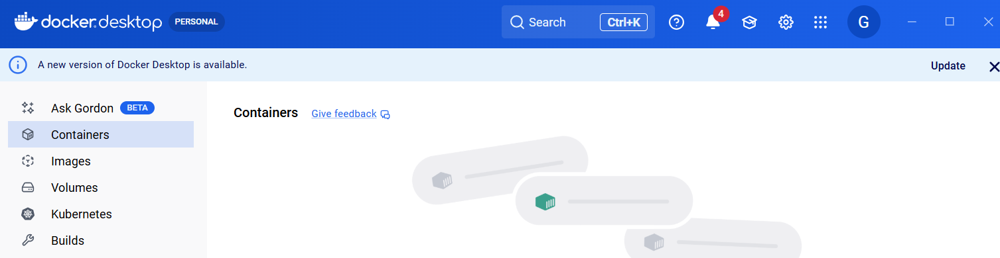

---
### 단계2: Docker Image 생성 
```shell
# Dockerfile이 있는 폴더로 이동 후 확인 
ls Dockerfile
```
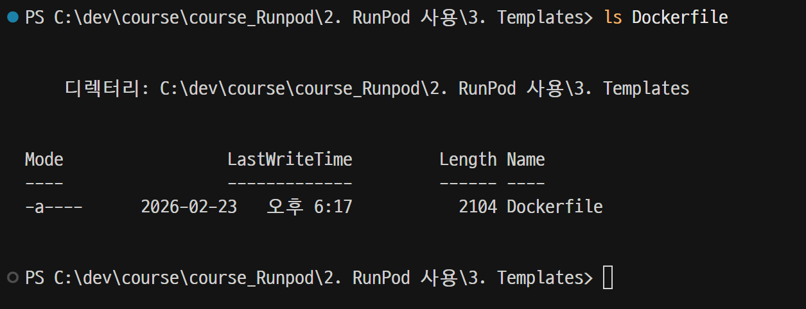

---
### 단계3: Docker Image 생성 
```shell
# docker build -t <Docker ID>/<생성될 이미지명>:<버전> .
docker build -t goodwon593/runpod-template:latest .
```
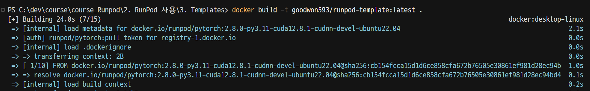

---
> 생성 결과 확인 

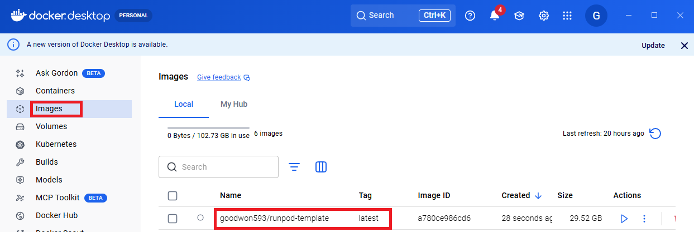

---
### 단계4: Docker Hub에 배포  
```shell
# docker push <Docker ID>/<생성될 이미지명>:<버전>
docker push goodwon593/runpod-template:latest
```
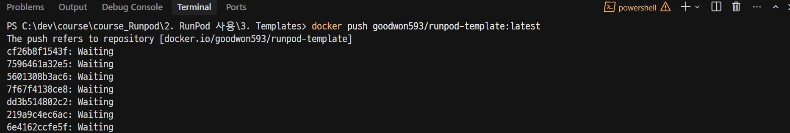

---
> [배포 결과 확인](https://hub.docker.com/) 

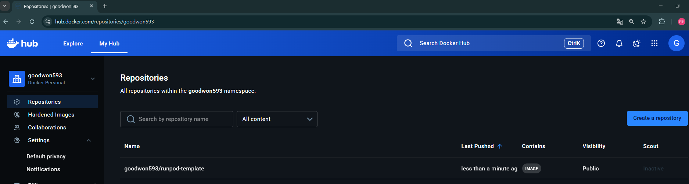

---
# Runpod Template 
> RunPod은 GPU 서버를 빌려서 쓰는 클라우드 서비스입니다.   
> Template은 그 서버를 어떻게 세팅할지 미리 정해놓은 설정 묶음입니다.

---
### [단계1: New Template](https://console.runpod.io/user/templates)
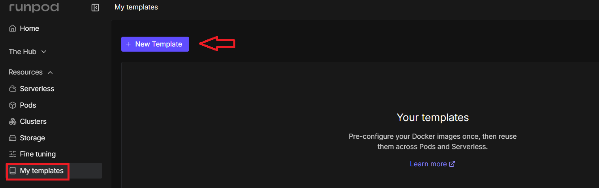

---
> Public template 설정 

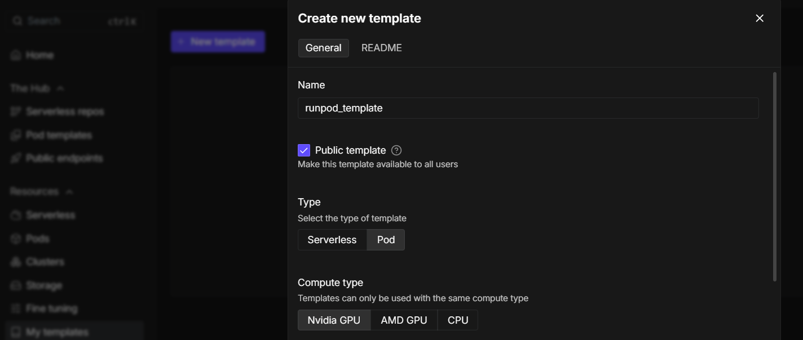


---
> Docker Hub Image 적용

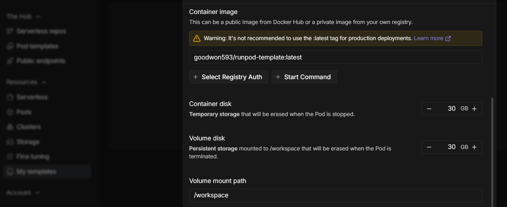

---
> VSCode Server Port 적용 

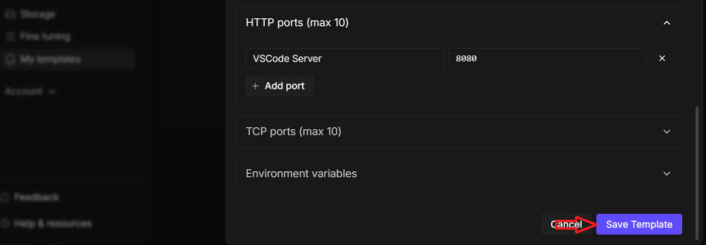

---
### 단계2: 생성된 Template 확인  
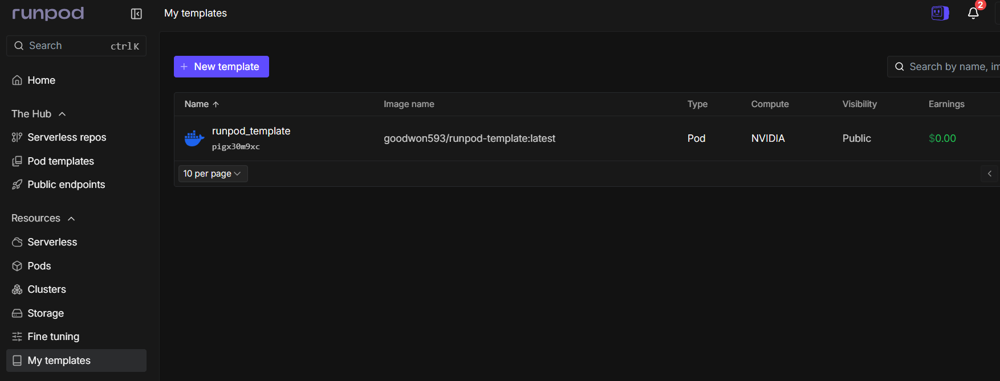

---
### 단계3: GPU Pod 선택 
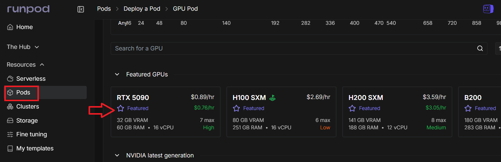

---
### 단계4: Change Template
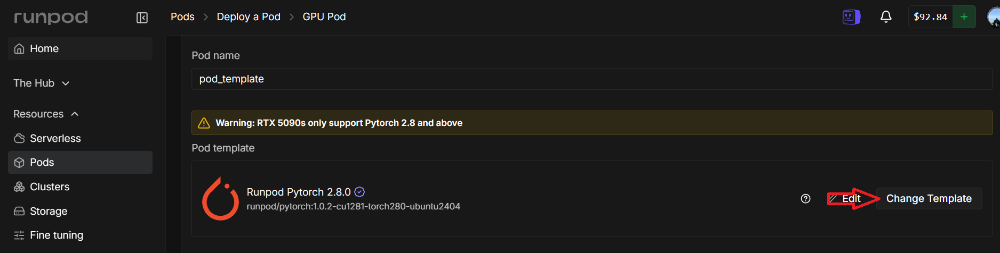

---
> 생성한 Template 선택 

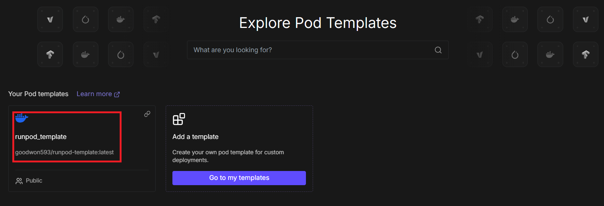

---
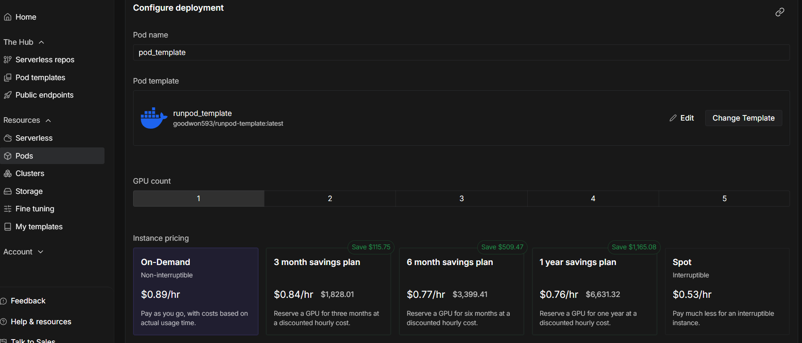

---
### 단계5: Deploy GPU Pod
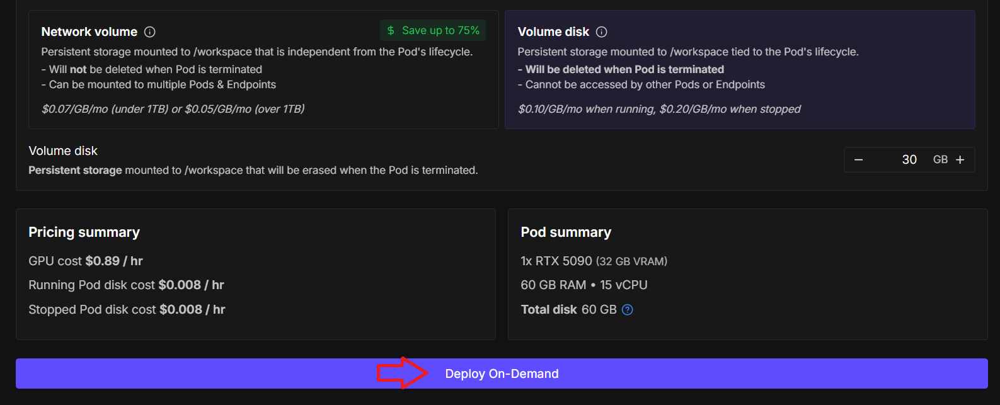

---
> Docker Image 다운로드

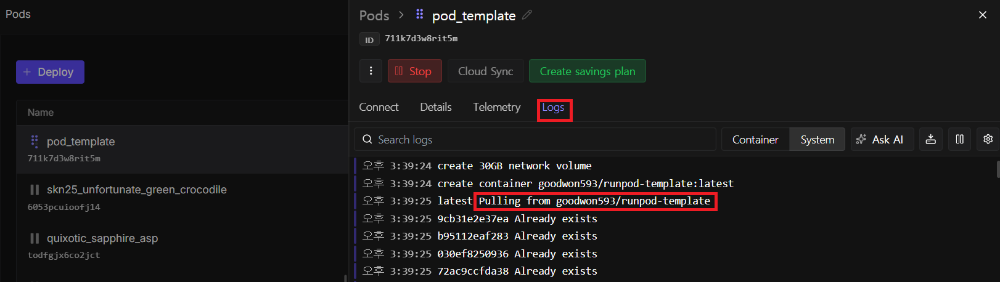

---
### 단계6: VSCode Server 접속  
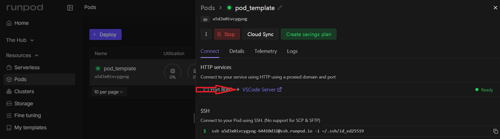

---
### 단계7: Jupyter 파일 확인    
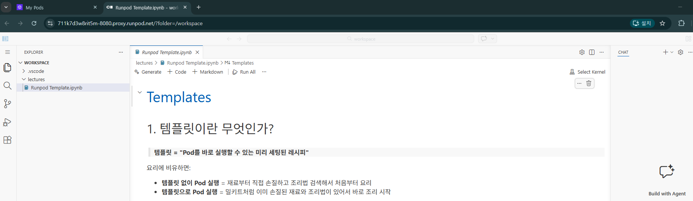
