# [Serverless](https://docs.runpod.io/serverless/overview)

---
## [요금](https://docs.runpod.io/serverless/pricing)
|  | Flex | Active |
|---|---|---|
| 비유 | 택시 (필요할 때만) | 전속 기사 (항상 대기) |
| 장점 | 안 쓸 때 돈 안 냄 | 빠른 응답, 할인 요금 |
| 단점 | 시작할 때 약간 느림 | 안 써도 돈 나감 |

---
### Flex Workers
- **일 안할 땐 꺼져 있음** (Scale to zero)
- 요청이 오면 켜지고, 끝나면 다시 꺼짐
- **가격이 더 비쌈** (기본 요금)
- 트래픽이 들쭉날쭉할 때 유리

---
### Active Workers
- **24시간 계속 켜져 있음**
- 요청이 오면 바로 처리 (대기 시간 거의 없음)
- **20~30% 더 저렴** (항상 쓰니까 할인)
- 트래픽이 꾸준히 많을 때 유리

---
### [GPU pricing](https://docs.runpod.io/serverless/pricing#gpu-pricing)
> Runpod 정책에 따라 매번 금액이 다를 수 있으므로, 공식 홈페이지에서 확인해야 함.

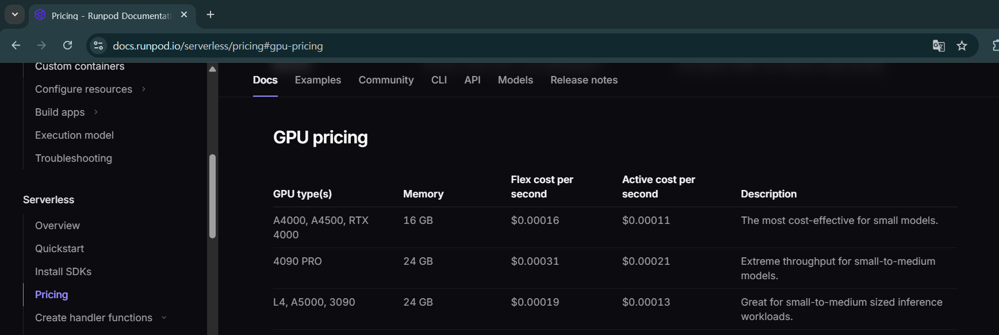

---
# [예제: Flex Workers with Ollama](https://docs.runpod.io/serverless/quickstart)

---
## 1. 코드 확인 

---
### 라이브러리 정의
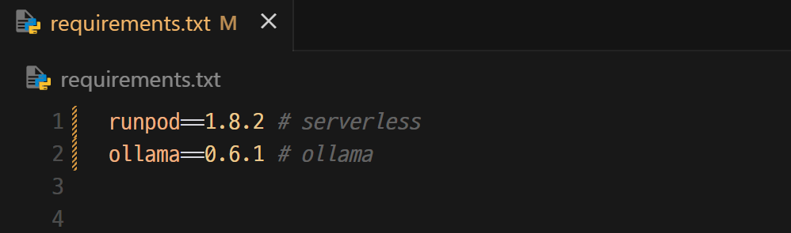

---
### runpod serverless 코드
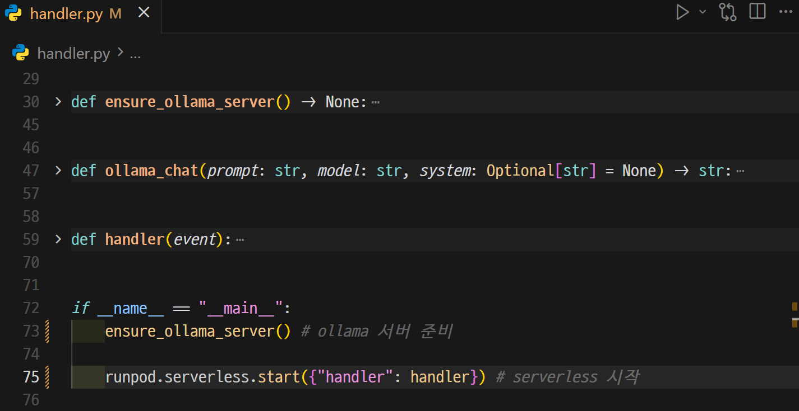

---
### 올라마 모델 다운로드
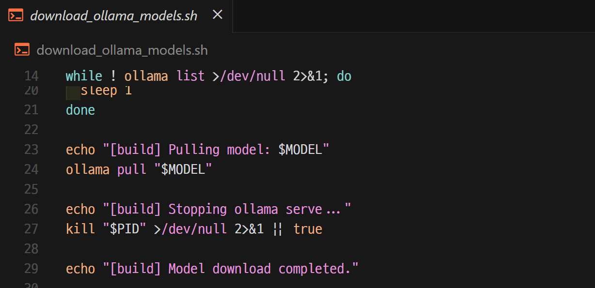

---
### 도커파일
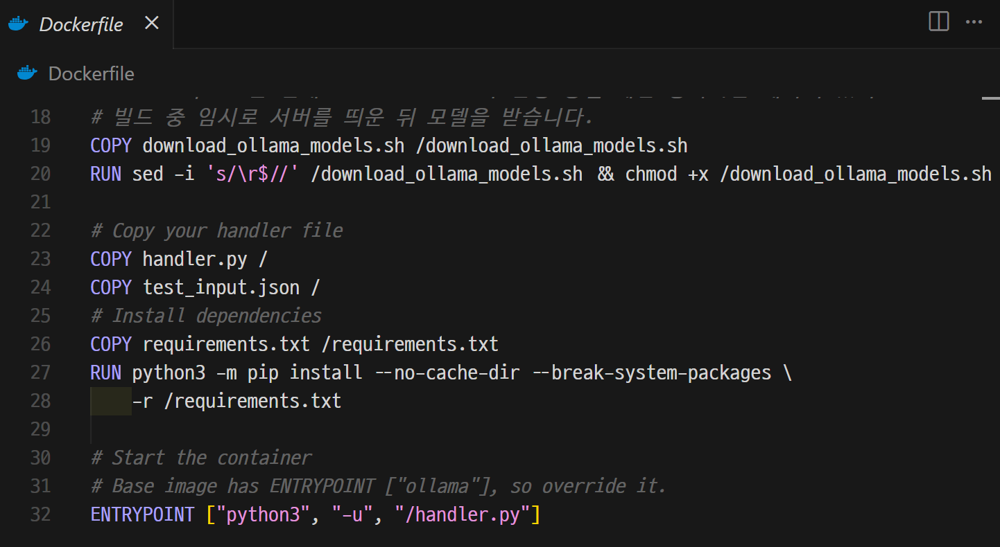

---
## 2. Docker

---
### 단계1: Docker Server 실행 및 로그인 
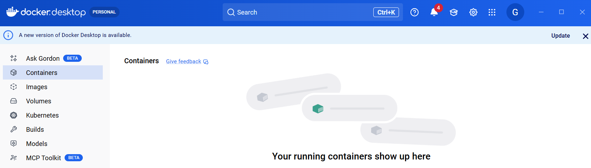

---
### 단계2: Docker Image 생성
```bash
# 도커파일이 있는 폴더에서 실행 
docker build --platform linux/amd64 -t [YOUR_USERNAME]/serverless-ollama:latest .
```
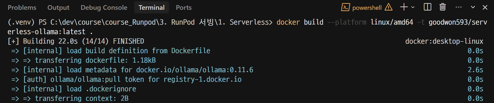

---
> 생성된 이미지 확인 

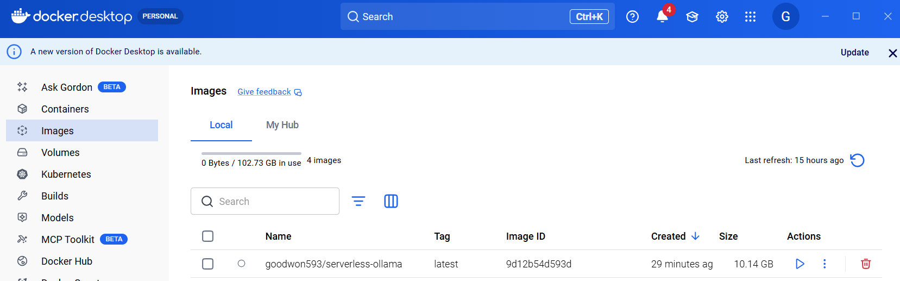

---
### 단계3: 생성된 Docker Image 테스트 
> test_input.json을 통해 테스트 진행됨.

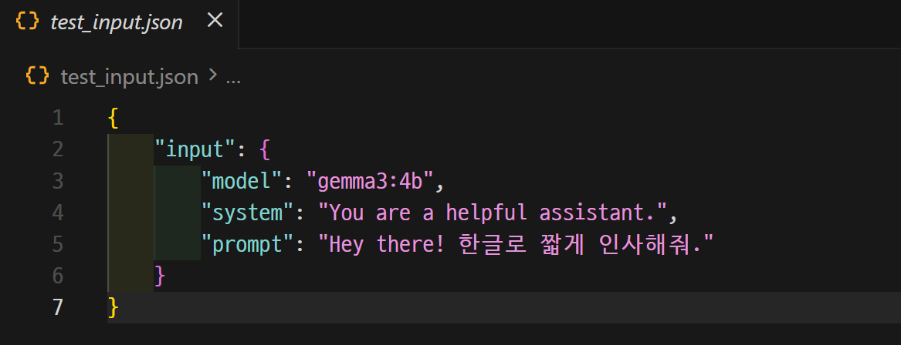

---
> 테스트 
```shell
docker run -it [YOUR_USERNAME]/serverless-ollama:latest
```
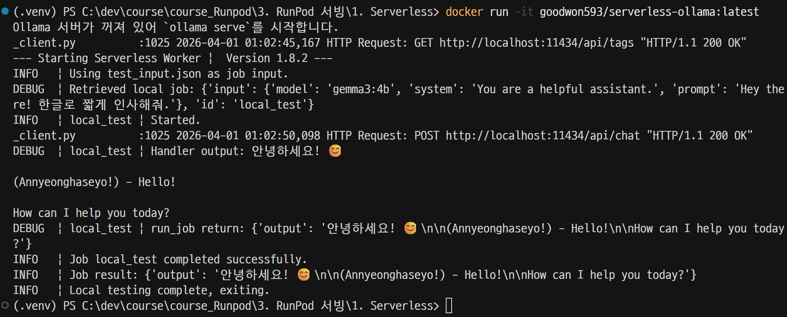

---
### 단계4: Docker Hub 배포 
```shell
docker push [YOUR_USERNAME]/serverless-ollama:latest
```
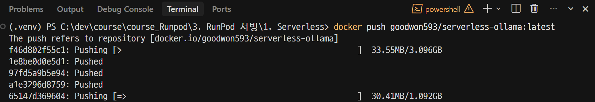

---
### 단계5: [Docker Hub](https://hub.docker.com/) 
> 결과 확인 

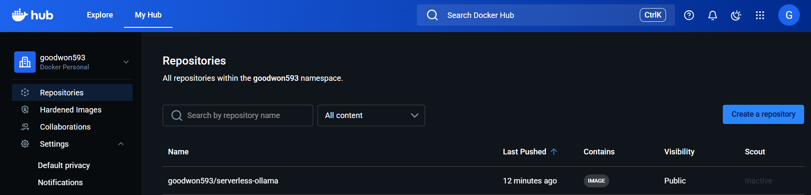

---
## 3. Runpod's Serverless

---
### 단계1: [Serverless > Get started](https://console.runpod.io/serverless)
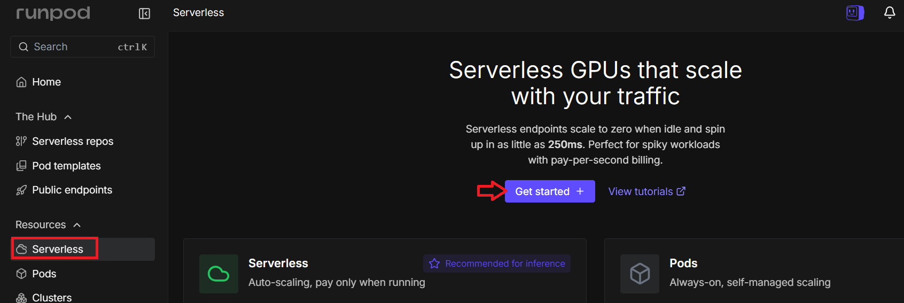

---
### 단계2: Create a new deployment
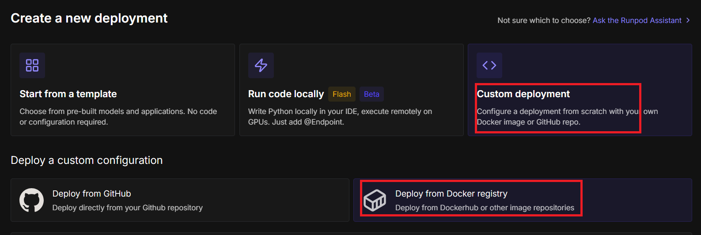

---
> Container image

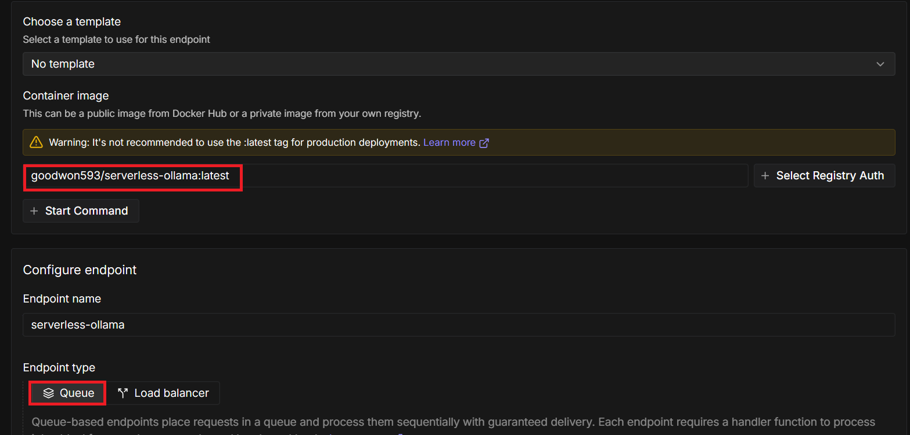

---
> Worker type

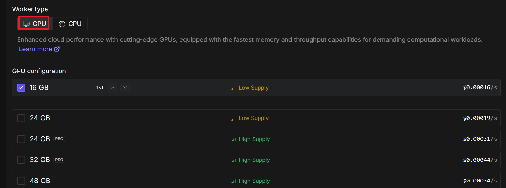

---
> Create endpoint

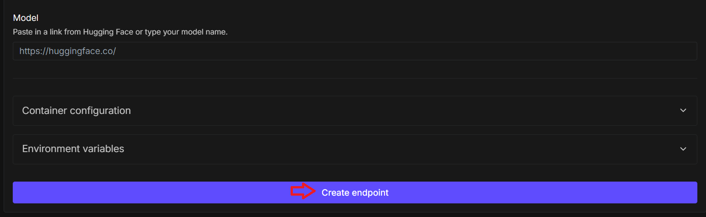

---
### 단계3: Serverless 테스트 
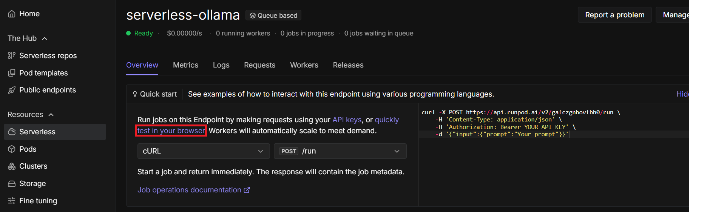

---
> 테스트 실행 

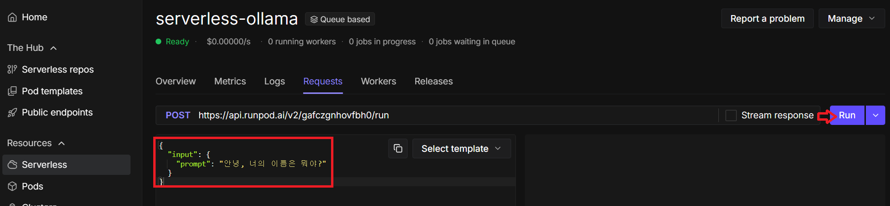

---
> 테스트 결과 

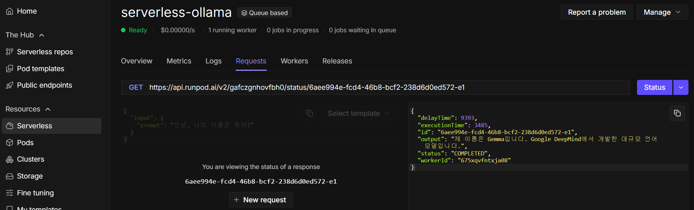
