# [vLLM](https://docs.vllm.ai/en/latest/)
> LLM(대형 언어 모델)을 **빠르고 효율적으로 실행**해주는 추론 엔진
 
쉽게 비유하면:
- LLM = 엄청 똑똑한 요리사
- vLLM = 요리사가 최대한 빠르게 일할 수 있게 해주는 주방 시스템

---
## [vLLM의 핵심 기능](https://www.sktenterprise.com/bizInsight/blogDetail/dev/14552)
 
| 기능 | 설명 |
|---|---|
| PagedAttention | GPU 메모리를 효율적으로 관리해서 더 많은 요청을 동시에 처리 |
| Continuous Batching | 요청이 들어오는 즉시 처리 (기다리지 않음) |
| OpenAI 호환 API | ChatGPT API와 동일한 형식 → 코드 변경 최소화 |

---
## vLLM 없이 vs. vLLM 있을 때

### vLLM 없이
```
요청 1 처리 → 완료 → 요청 2 처리 → 완료 → 요청 3 처리...
(한 번에 하나씩)
```

### vLLM 있을 때
```
요청 1, 2, 3 → 동시에 묶어서 처리 → 훨씬 빠름
(여러 개를 한꺼번에)
```

---
# [RunPod Serverless with vLLM](https://docs.runpod.io/serverless/vllm/overview)
> RunPod Serverless는 vLLM을 공식 지원함.

---
## RunPod Serverless 종류 

| | Flex Workers | Active Workers |
|---|---|---|
| 상태 | 요청 시 켜짐, 유휴 시 꺼짐 | 항상 켜져 있음 |
| Cold Start | **있음** | **없음** |
| 비용 | 실행 시간만 과금 | 유휴 시에도 과금 |
| 할인 | 없음 | 20~30% 할인 |
| 기본값 | Max Workers 수만큼 | 0 |

> Cold Start란?
> 요청이 들어왔는데 실행 중인 Worker가 없을 때, GPU를 새로 띄우는 데 걸리는 시간

---
### Cold Start의 실서비스 문제점
1. 응답 시간이 예측 불가능하다
    - 같은 API인데 호출할 때마다 응답 시간이 달라짐
2. 사용자 경험(UX)이 망가진다
    - SLA(응답 시간 보장) 맞추기 불가능
3. 타임아웃 에러가 발생한다
    - 클라이언트 측 타임아웃 설정보다 Cold Start가 더 오래 걸리면 에러

---
### vLLM에서 Cold Start가 특히 심한 이유
- LLM은 모델 파일 자체가 엄청 크기 때문
- 아무리 vLLM으로 추론을 빠르게 최적화해도,  Cold Start가 있으면 첫 응답은 무조건 느림

| 모델 | 모델 크기 | 예상 Cold Start |
|---|---|---|
| Llama 3 8B | ~16GB | 1~2분 |
| Llama 3 70B | ~140GB | 5~10분 |
| Mistral 7B | ~14GB | 1~2분 |

### 해결책: Active Workers
- Worker를 항상 켜두는 설정   → Cold Start 완전히 제거

---
# [예제: Active Workers with vLLM](https://docs.runpod.io/serverless/vllm/overview)

---
## 1. Docker

---
### 단계1: Docker Server 실행 및 로그인 
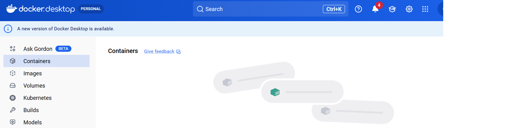

---
### 단계2: Docker Image 생성
```bash
# 도커파일이 있는 폴더에서 실행 
docker build --platform linux/amd64 -t [YOUR_USERNAME]/serverless-vllm:latest .
```
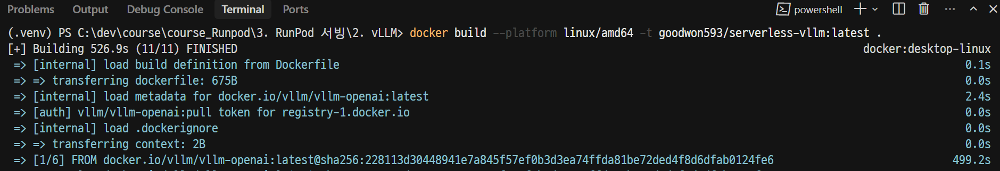

---
### 단계3: 생성된 Docker Image 확인 

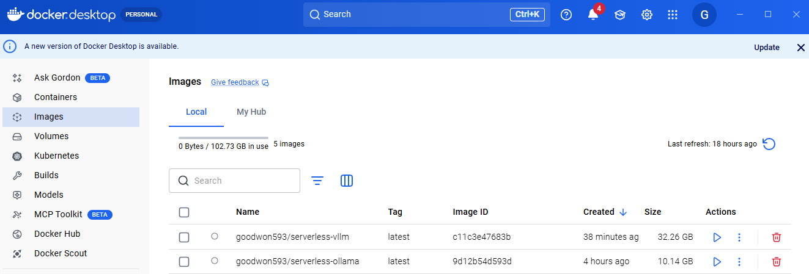

---
### 단계4: Docker Hub 배포 
```shell
docker push [YOUR_USERNAME]/serverless-vllm:latest
```
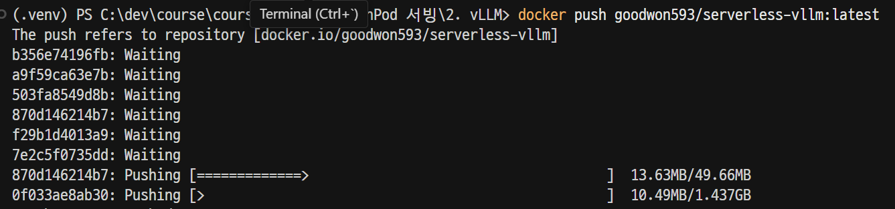

---
### 단계5: [Docker Hub](https://hub.docker.com/) 
> 결과 확인 

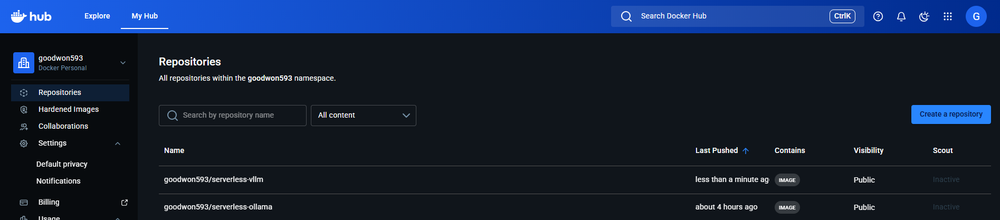

---
## 2. Runpod's Serverless(Active Workers)

---
### 단계1: [Serverless > Get started](https://console.runpod.io/serverless)
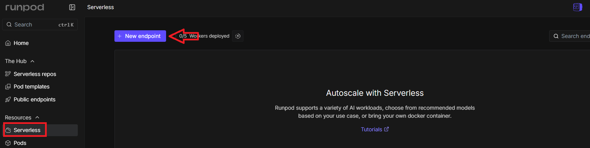


---
### 단계2: Create a new deployment
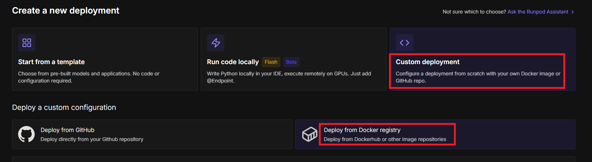

---
> Container image

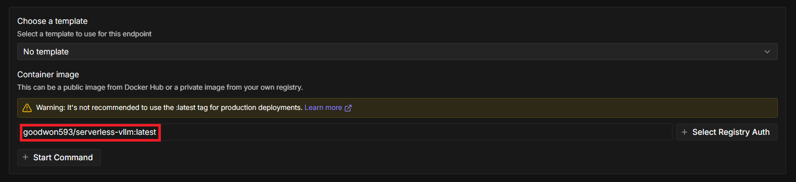

---
> Worker type

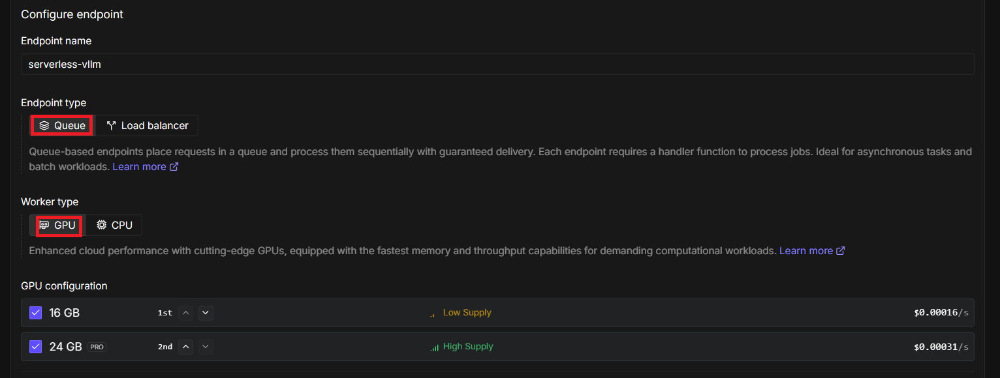

---
### 단계3: Create endpoint
> [HuggingFace API 생성](https://huggingface.co/settings/tokens)  

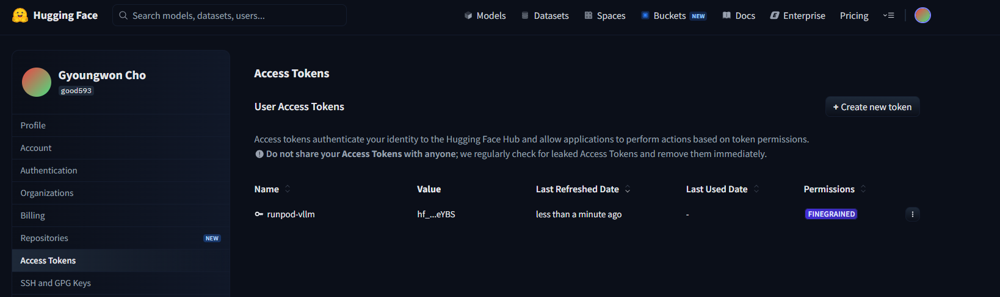

---
> `HF_TOKEN`: `생성된 HuggingFace API`

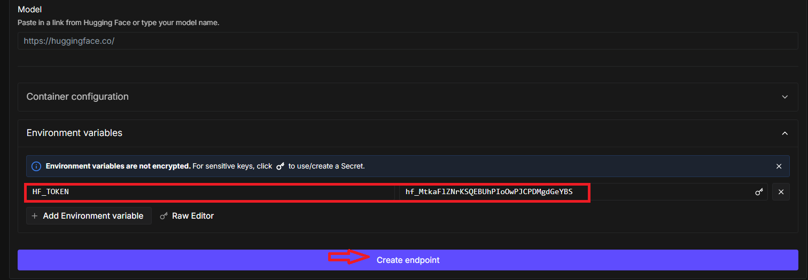

---
### 단계4: Active Workers 적용
> Cold Start 문제 해결 

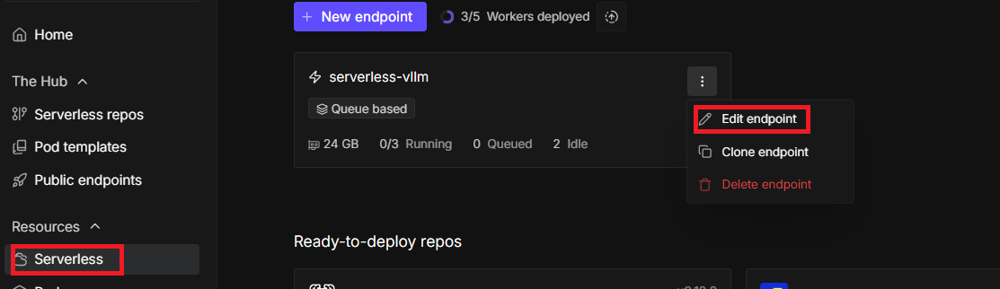

---
> Active workers 1개 이상으로 수정 
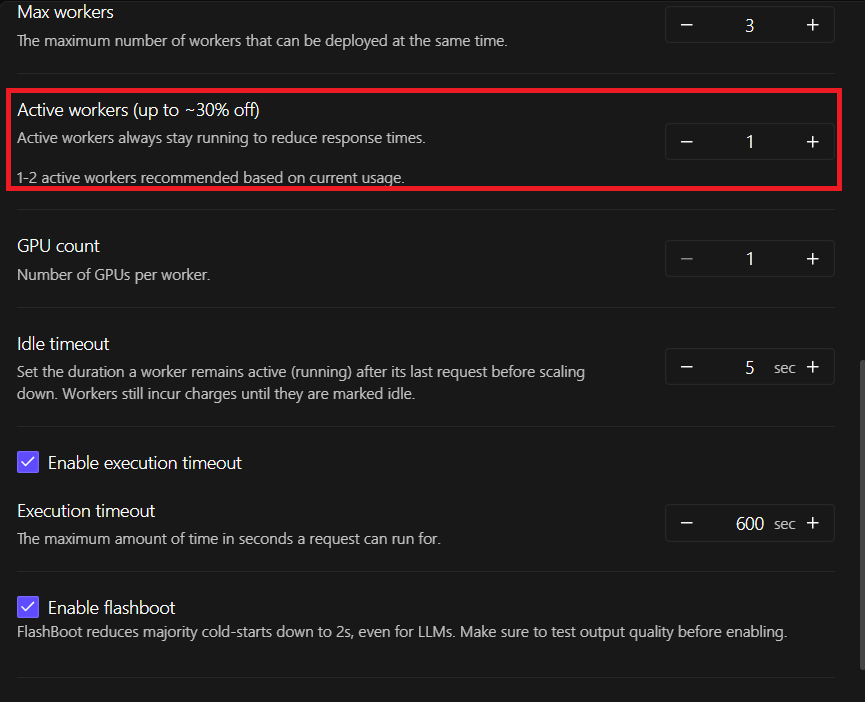

---
> Save Endpoint

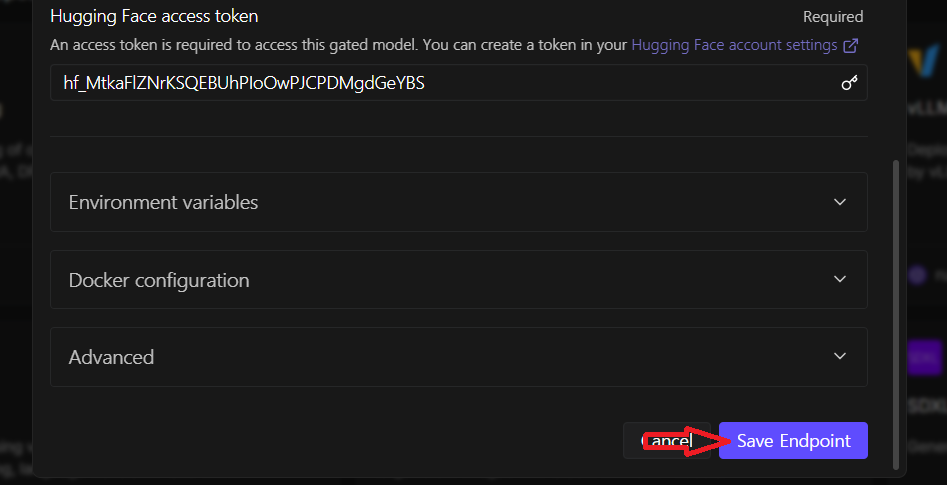

---
> (시간이 조금 걸림) Active workers 적용 확인 

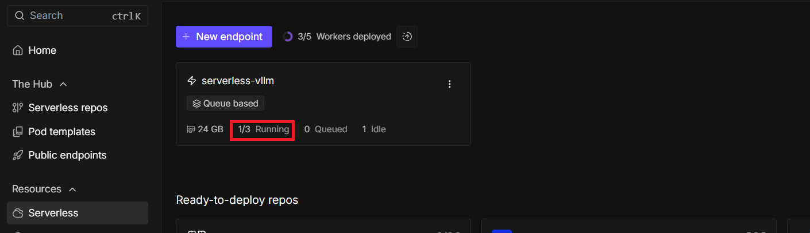

---
### 단계5: 테스트 
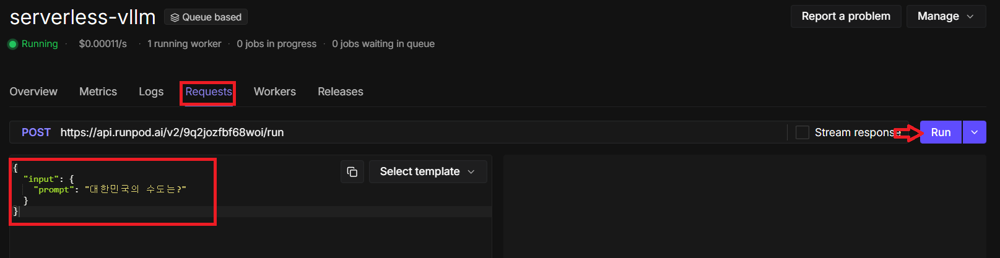

---
> LLM 답변 확인 

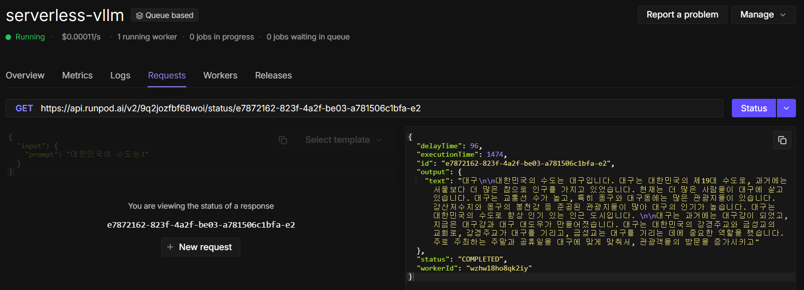
