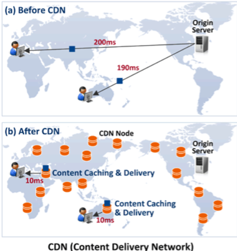
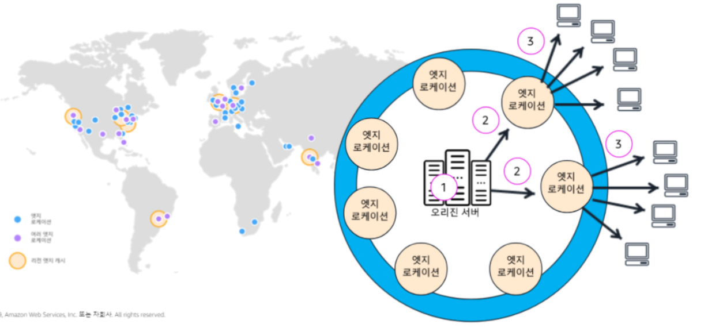
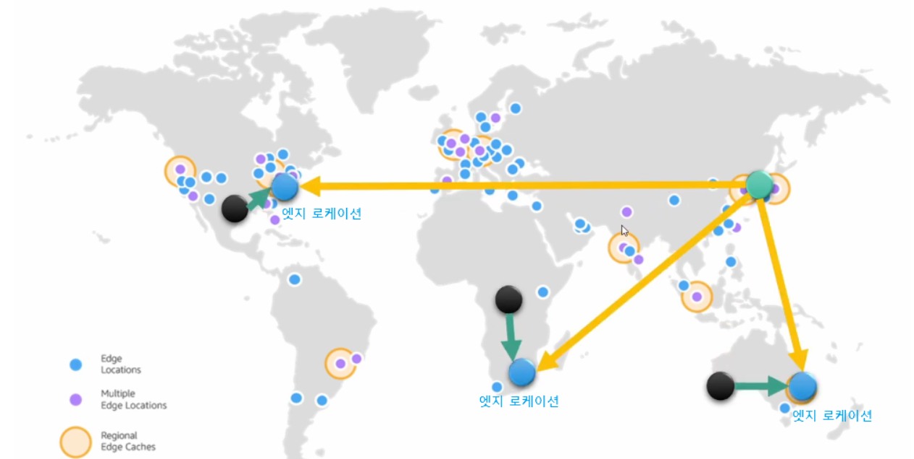
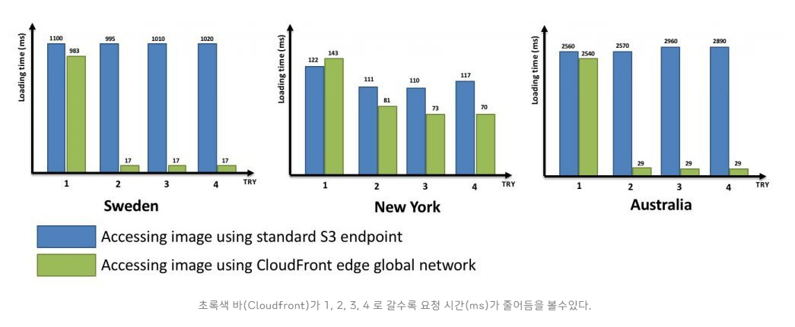

# [CDN(Content Delivery Network)이란?](https://inpa.tistory.com/entry/AWS-%F0%9F%93%9A-CloudFront-%EA%B0%9C%EB%85%90-%EC%9B%90%EB%A6%AC-%EC%82%AC%EC%9A%A9-%EC%84%B8%ED%8C%85-%F0%9F%92%AF-%EC%A0%95%EB%A6%AC) 
> 콘텐츠를 효율적으로 전달하기 위해 여러 노드를 가진 네트워크에 데이터를 저장하여 제공하는 시스템이다.



---
## CDN이 필요한 상황

서울에 있는 서버 하나가 전 세계 사용자의 이미지, CSS, JS, 동영상을 모두 직접 응답한다고 가정해봅시다.

- 사용자와 서버 사이의 물리적 거리가 멀수록 지연 시간이 커진다.
- 인기 콘텐츠 요청이 몰리면 원본 서버의 CPU, 네트워크, 비용 부담이 커진다.
- 정적 파일은 매번 원본 서버가 계산하거나 읽어줄 필요가 없다.

CDN은 사용자 가까이에 콘텐츠 복사본을 두고 응답하는 방식으로 이 문제를 줄입니다.

---

## CDN 한 줄 정의

CDN(Content Delivery Network)은 전 세계 여러 지점의 캐시 서버에 콘텐츠를 저장하고, 사용자에게 가까운 서버에서 빠르게 전달하는 네트워크입니다.

대표적인 캐시 대상:

- 이미지, CSS, JavaScript
- 동영상, 문서, 다운로드 파일
- API 응답 중 캐시 가능한 결과
- SPA의 정적 빌드 파일

---

## Origin과 Edge

| 용어 | 의미 | 예시 |
| --- | --- | --- |
| Origin | 원본 콘텐츠가 있는 서버 | S3 bucket, EC2, ALB, 외부 HTTP 서버 |
| Edge Location / POP | 사용자와 가까운 CloudFront 캐시 지점 | 전 세계 CloudFront 엣지 |
| Regional Edge Cache | POP과 Origin 사이의 더 큰 캐시 계층 | 덜 인기 있는 객체를 더 오래 보관 |
| Viewer | 콘텐츠를 요청하는 사용자 또는 브라우저 | Chrome, 모바일 앱 |

---
# [AWS CloudFront](https://aws.amazon.com/ko/cloudfront/)

Amazon CloudFront는 AWS의 CDN 서비스입니다.

- 전 세계 엣지 로케이션을 통해 콘텐츠를 빠르게 전달한다.
- S3, EC2, ALB, API 서버 같은 Origin 앞에 둘 수 있다.
- HTTPS, AWS WAF, Signed URL/Cookie, 지리적 제한 등 보안 기능과 연결된다.
- 정적 콘텐츠뿐 아니라 일부 동적 요청도 네트워크 최적화, TLS 처리, 보안 계층으로 활용할 수 있다.

---


---
## CloudFront 기본 흐름

```text
Viewer
  |
  | 1. https://dxxxxx.cloudfront.net/logo.png 요청
  v
CloudFront Edge Location
  |
  | 2. 캐시에 있으면 바로 응답: Cache Hit
  | 3. 캐시에 없으면 Origin으로 요청: Cache Miss
  v
Origin(S3, EC2, ALB, API)
  |
  | 4. 원본 응답을 Edge에 저장하고 Viewer에게 전달
  v
Viewer
```
---


---
## CloudFront 장점 
- AWS 네트워크를 사용하면 사용자의 요청이 반드시 통과해야 하는 네트워크의 수가 줄어들어 **성능이 향상**
- 파일의 첫 바이트를 로드하는 데 걸리는 지연 시간이 줄어들고 **데이터 전송 속도가 빨라진다.**
- 파일(객체)의 사본이 전 세계 여러 엣지 로케이션에 유지(또는 캐시)되므로 안정성과 가용성이 향상
- 보안성 향상
  - **오리진 서버에 대한 종단 간 연결의 보안이 보장됨(https)**
  - 서명된 URL 및 쿠키 사용 옵션으로 자체 사용자 지정 오리진에서 프라이빗 콘텐츠를 제공하도록 할 수 있음

---


---
## [CloudFront 비용](https://aws.amazon.com/ko/cloudfront/pricing/)

| 플랜       | 월 요금      | 데이터 전송     | 요청 수      | 추천 대상       |
| -------- | --------- | ---------- | --------- | ----------- |
| Free     | 무료        | 100GB      | 100만      | 학습, 개인 프로젝트 |
| Pro      | 월 요금제     | 50TB       | 1,000만    | 소규모 서비스     |
| Business | 월 요금제     | 50TB       | 1억 2,500만 | 기업 서비스      |
| Premium  | $1,000~/월 | 50TB~600TB | 5억~60억    | 대규모 서비스     |


---
> 프로젝트(React + S3 + CloudFront)에서 실제 비용

| 사용량            |          예상 비용 |
| -------------- | -------------: |
| 월 방문자 100명     |          거의 무료 |
| 월 방문자 1,000명   |        무료~수백 원 |
| 월 방문자 10,000명  | 약 1,000~5,000원 |
| 월 방문자 100,000명 |        수만 원 수준 |

---
### S3와 함께 사용할 경우
| 구간                           | 비용            |
| ---------------------------- | ------------- |
| S3 → CloudFront              | 무료          |
| CloudFront → 사용자             | 유료            |
| 사용자 → CloudFront             | 무료            |
| CloudFront 캐시 적중(Cache Hit)  | S3 요청 없음      |
| CloudFront 캐시 미스(Cache Miss) | S3에서 한 번만 가져옴 |


---

## Distribution

Distribution은 CloudFront 배포 단위입니다.

- CloudFront 도메인 이름을 가진다. 예: `d111111abcdef8.cloudfront.net`
- 하나 이상의 Origin을 연결한다.
- 요청 경로별 Cache Behavior를 설정한다.
- HTTPS, WAF, 로그, 지리적 제한, 가격 등급 등을 설정한다.

학생들이 기억할 문장:

> Distribution은 "어떤 Origin을, 어떤 규칙으로, 전 세계 Edge에 배포할지" 정의한 설정 묶음입니다.

---
### Origin

Origin은 CloudFront가 원본 파일이나 응답을 가져오는 위치입니다.

자주 쓰는 Origin:

- S3 bucket: 정적 웹, 이미지, 다운로드 파일
- EC2 또는 ALB: 웹 서버, API 서버
- Media 서비스: 동영상 스트리밍
- 외부 HTTP 서버: AWS 밖의 기존 서버

---
### S3 Origin 선택 기준

| 방식 | 특징 | 권장 상황 |
| --- | --- | --- |
| S3 REST endpoint | bucket을 private으로 유지하고 OAC 사용 가능 | 일반적인 정적 사이트 배포 |
| S3 website endpoint | S3 정적 웹 사이트 호스팅 기능 사용 | S3 웹 사이트 리다이렉트 기능이 꼭 필요할 때 |

> OAC(Origin Access Control) 는 CloudFront만 S3 버킷에 접근할 수 있도록 허용하는 보안 기능입니다.
